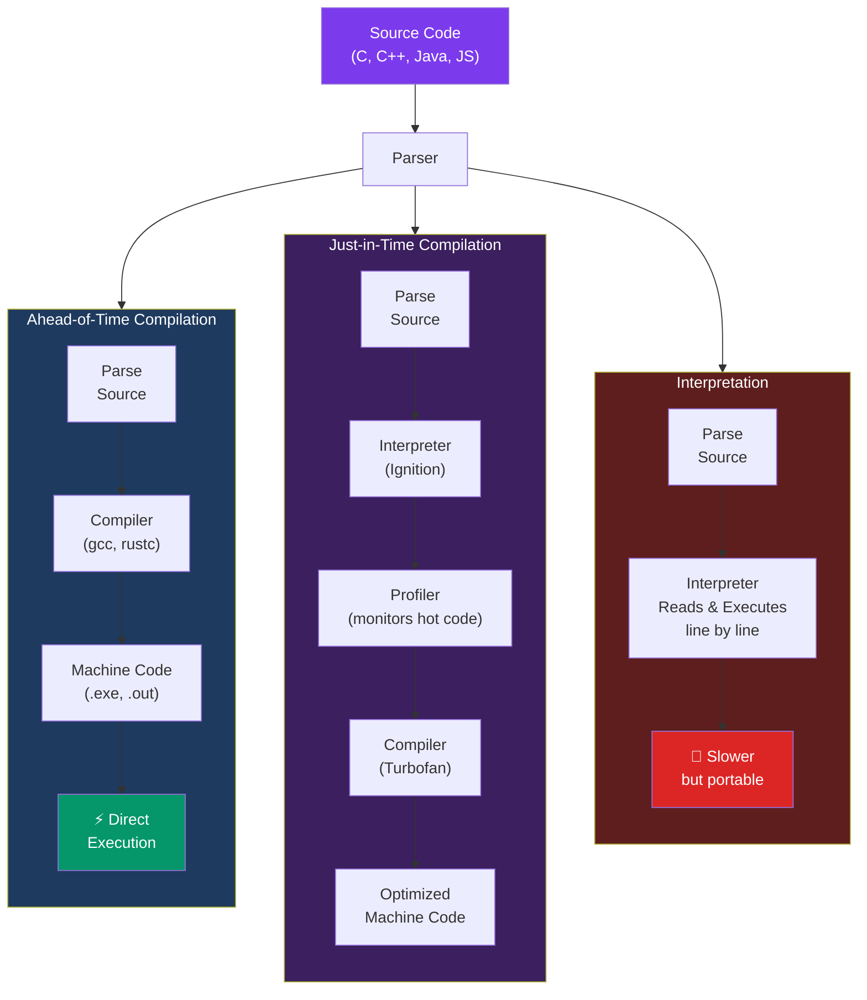

## JS Compilation Techniques

Compiling is the process of translating source code written in a high-level programming language into machine-readable code, which can be executed by a computer's processor. There are different types of compilation techniques used to achieve this translation. Let's explore three main types: ahead-of-time compilation, just-in-time compilation, and interpretation.

1. **Ahead-of-Time Compilation (AOT):**

   In AOT compilation, the source code is translated into machine code before the program is executed. This compiled machine code can be directly run by the computer's processor without the need for further translation during runtime.

   Advantages:
   - Programs compiled with AOT tend to run faster since there is no runtime translation overhead.
   - AOT-compiled programs generally have a smaller memory footprint compared to programs that rely on runtime translation.

   Disadvantages:
   - AOT compilation can lead to longer initial compilation times, especially for larger programs.
   - Changes to the source code often require recompilation.

   Examples of languages that typically use AOT compilation: C, C++, Fortran.

2. **Just-in-Time Compilation (JIT):**

   JIT compilation combines aspects of both traditional compilation and interpretation. In JIT compilation, the source code is initially interpreted, but as the program runs, certain parts of the code are compiled into machine code on-the-fly. This compiled code is cached and can be reused for subsequent executions.

   Advantages:
   - JIT compilation combines the benefits of interpretation (easier debugging, platform independence) with the performance gains of compiled machine code.
   - JIT-compiled programs can take advantage of runtime profiling to optimize frequently executed code paths.

   Disadvantages:
   - There might be a slight overhead during the initial execution as the interpreter translates parts of the code to machine code.
   - JIT compilation can lead to increased memory usage due to both the original source code and the generated machine code being present in memory.

   Examples of languages that use JIT compilation: Java, C#, JavaScript (in modern browsers), Python (using tools like PyPy).

3. **Interpretation:**

   In interpretation, the source code is not compiled into machine code beforehand. Instead, an interpreter reads the source code line by line and executes it directly. The interpreter translates and executes the program's instructions in real-time.

   Advantages:
   - Easier to develop and debug since errors can be spotted as the code is executed line by line.
   - Highly portable, as the interpreter itself can be written for different platforms.

   Disadvantages:
   - Generally slower execution speed compared to compiled languages.
   - Lack of certain performance optimizations that compiled languages can achieve.

   Examples of languages that are often interpreted: Python, Ruby, JavaScript (in some contexts), BASIC.

[Back to Index](#index)

---