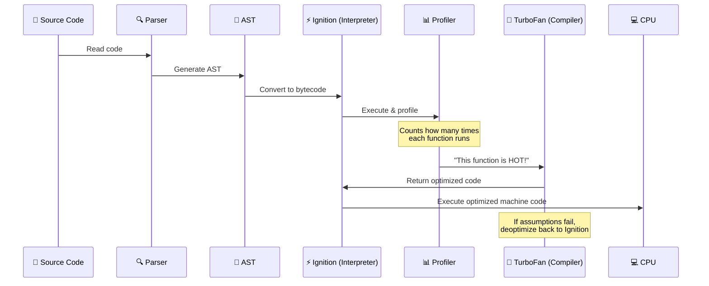

# Compilation vs Interpretation

> **JavaScript is NOT just interpreted anymore.** Modern engines use a hybrid approach called **JIT (Just-In-Time) Compilation** that gives you the best of both worlds.

## Why Do We Need This?

Understanding how your code runs helps you:
- Write **faster** code (know what the engine optimizes)
- Understand **why** certain patterns are slower
- Debug **performance issues** effectively
- Answer one of the **most common interview questions**

## Visual Explanation


## Comparison Table

| Aspect | AOT (C, C++, Rust) | Interpretation (Python, Ruby) | JIT (JavaScript, Java) |
|--------|-------------------|------------------------------|----------------------|
| **Startup speed** | ❌ Slow (must compile first) | ✅ Instant | ✅ Fast (starts interpreting) |
| **Execution speed** | ✅ Fast (optimized binary) | ❌ Slow (line by line) | ✅ Fast (hot paths optimized) |
| **Platform** | Fixed (compiled for one OS) | Any (interpreter handles it) | Any (JIT adapts) |
| **Optimization** | At compile time | None | At runtime (adaptive) |
| **Memory** | Low | Higher | Medium |

## How JavaScript's JIT Works



## Step by Step

1. **You write** `const sum = (a, b) => a + b;`
2. **Parser** breaks it into tokens → creates an AST
3. **Ignition (Interpreter)** runs the code immediately → generates bytecode
4. **Profiler** watches: is `sum()` called 100+ times? If yes → it's "hot"
5. **TurboFan (Compiler)** takes the hot code → compiles to **native machine code**
6. **CPU** executes the optimized code at native speed
7. If optimizations break (e.g., `sum` gets a string instead of number), **deoptimize** back to interpreted mode

## 💡 Did You Know?

> Early JavaScript (1995–2008) was purely interpreted. It was **slow** — that's why AJAX-heavy apps didn't exist until V8 arrived in 2008 and made JS fast with JIT compilation.

## 🚀 Best Practices for JIT-Friendly Code

```javascript
// ✅ DO: Keep functions monomorphic (same argument types)
function add(a, b) {
  return a + b;
}
add(1, 2);      // number + number → JIT optimizes for numbers
add(3, 4);      // same type → fast path

// ❌ DON'T: Change argument types (polymorphic)
add(1, 2);      // number
add("1", "2");  // string → JIT must deoptimize and recompile
add(true, 1);   // boolean → deoptimized again
```

## 🎯 Interview Tip

> **Q:** "Is JavaScript compiled or interpreted?"
> **A:** "Modern JavaScript uses **JIT (Just-In-Time) compilation**. It starts by **interpreting** code quickly (via Ignition in V8), then **profiles** it at runtime. Frequently used code paths are **compiled to optimized machine code** (via TurboFan). If assumptions change, it **deoptimizes** back to interpreted. This gives both fast startup and fast execution."

## ✅ Summary

- Pure **interpretation**: fast startup, slow execution
- Pure **AOT compilation**: slow startup, fast execution
- **JIT compilation** (modern JS): fast startup + fast execution
- V8's pipeline: Parse → Ignition (interpret) → Profiler → TurboFan (compile)
- Write **predictable** code so JIT can optimize effectively

## 🔗 Related Topics

- [JavaScript Engines](./javascript-engines) — Who implements JIT
- [JavaScript Runtime](./javascript-runtime) — The environment beyond the engine

---

> 💡 **Remember:** You don't need to memorize all of this to write JavaScript. But understanding JIT helps you write **faster** code and ace interviews.
