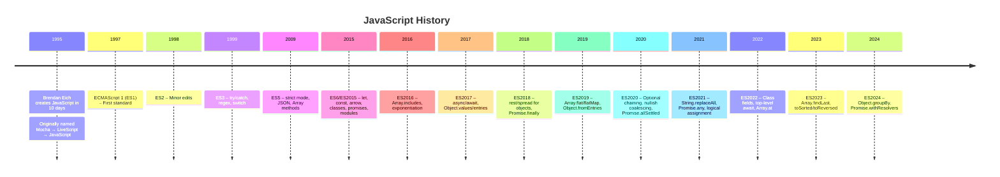
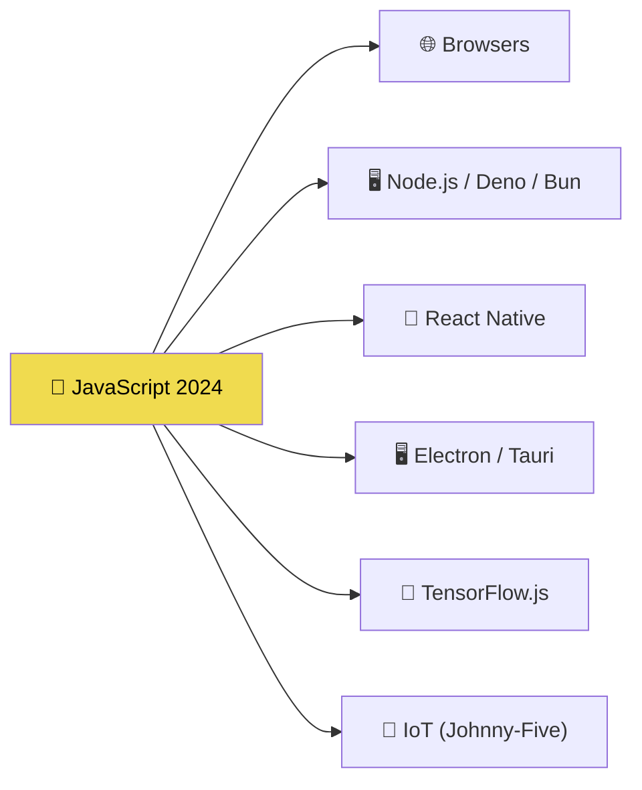

# The History of JavaScript

> From a simple browser scripting language to a universal runtime — JavaScript's journey is one of the most remarkable stories in software engineering.

## Why Do We Need This?

Understanding JavaScript's history helps you:
- Appreciate **why** certain features exist (and quirks remain)
- Understand **why** some patterns emerged (IIFE, transpilers)
- Anticipate **where** the language is heading
- Ace interview questions about ECMAScript versions

## Real World Story

> **"10 days to change the world"** — In May 1995, Netscape hired Brendan Eich and told him to create a scripting language for the browser. He had 10 days. The result? JavaScript.

The language was quickly thrown together under enormous pressure. This explains many of JavaScript's infamous quirks:
- `typeof null === "object"` — a bug that became a feature
- Loose equality `==` coercion — designed for beginners
- No module system — the web was simple back then

## Timeline



## Detailed Breakdown

### 1995 — The Birth (10 Days)

Brendan Eich, working at Netscape, created the first version in **10 days**. The language was:
- Originally called **Mocha** (internal codename)
- Then **LiveScript** (developer preview)
- Finally **JavaScript** (marketing decision — riding Java's popularity wave)

> 💡 **Did You Know?** JavaScript has nothing to do with Java. The name was a marketing ploy by Netscape to capitalize on Java's hype.

### 1996–1999 — Browser Wars & Standardization

| Year | Event | Impact |
|------|-------|--------|
| 1996 | Microsoft creates JScript | Competing implementation, causes compatibility issues |
| 1997 | ECMAScript 1 standardized | Language gets a formal specification (ECMA-262) |
| 1999 | ES3 released | `try/catch`, regex, `switch` — language matures |

### 2000–2009 — The Dark Ages

For **10 years**, JavaScript didn't get a new version. But the community innovated:
- 2005: **AJAX** (Jesse James Garrett) — web apps become dynamic
- 2006: **jQuery** — makes DOM manipulation cross-browser
- 2008: **V8 engine** (Google Chrome) — JavaScript becomes FAST

### 2009 — ES5: The Renaissance

After a decade, ES5 arrived with major improvements:
- `"use strict"` mode — catch common errors
- `JSON.parse/stringify` — data handling
- `Array.map/filter/reduce` — functional programming
- `Object.create/defineProperty` — better object control

### 2015 — ES6: The Revolution

The biggest update in JavaScript history:
```javascript
// Before ES6
var name = "Alice";
function greet(name) {
  return "Hello, " + name + "!";
}

// ES6 brings:
let name = "Alice";         // block-scoped
const PI = 3.14;           // constant
const greet = (name) =>    // arrow function
  `Hello, ${name}!`;       // template literal
```

ES6 introduced: `let/const`, arrow functions, classes, promises, modules, destructuring, spread/rest, template literals, Symbols, Map/Set, generators, iterators, and `for...of`.

### 2016–2024 — Annual Updates

Since 2015, a new ECMAScript version is released **every year**, each adding smaller, well-designed features:

```javascript
// ES2017 — async/await
async function fetchUser(id) {
  const res = await fetch(`/api/${id}`);
  return res.json();
}

// ES2020 — Optional chaining
const city = user?.address?.city ?? "Unknown";
```

### The Future: JavaScript Today



## ⚠ Common Mistakes

```javascript
// ❌ Thinking JavaScript is "Java light"
// They are completely different languages!

// ❌ Not knowing ES version differences
// ES5 doesn't support arrow functions!
// const add = (a, b) => a + b; → SyntaxError in old browsers
```

## 🎯 Interview Tip

> **Q:** What's the difference between JavaScript and ECMAScript?
> **A:** ECMAScript is the **specification** (the rules). JavaScript is the **implementation** (what actually runs). Think of it like a blueprint vs. the building.

## ✅ Summary

- Created in 1995 by Brendan Eich in 10 days
- Standardized as ECMAScript (annual updates since 2015)
- ES6 (2015) was the biggest transformation
- Now an annual release cycle with incremental improvements
- Runs everywhere: browsers, servers, mobile, desktop, IoT

## 🔗 What's Next?

- [JavaScript vs ECMAScript](./javascript-vs-ecmascript) — The spec vs the language
- [JavaScript Engines](./javascript-engines) — How code actually runs

---

> 💡 **Key Insight:** JavaScript's chaotic history is why it has quirks. Modern JavaScript (ES6+) is a clean, powerful language. Focus on modern features — the quirks are just footnotes.
