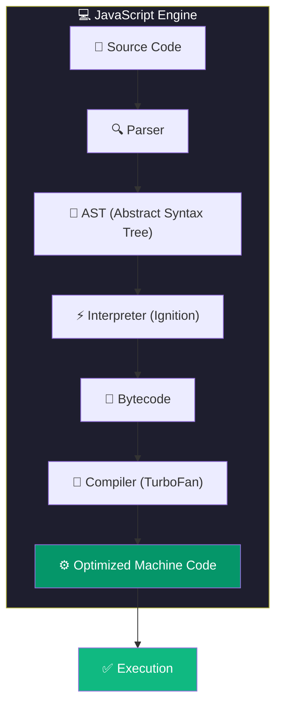
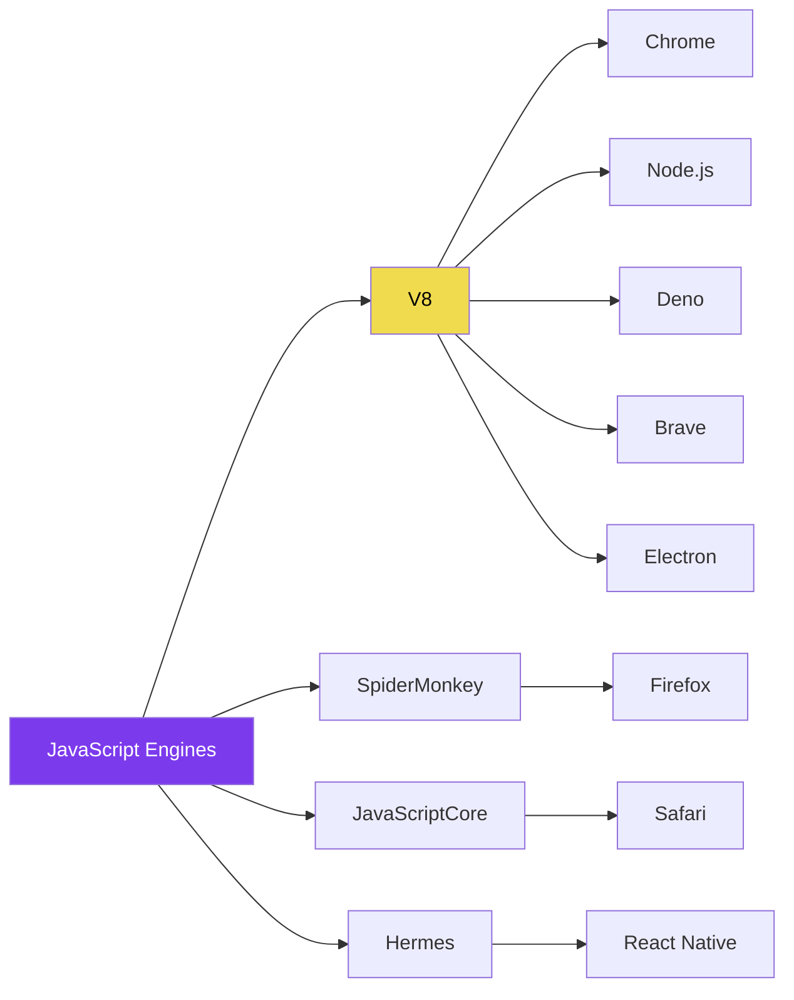
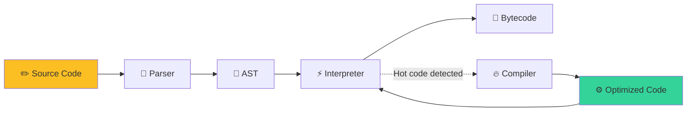

# JavaScript Engines

> A **JavaScript engine** is a program that executes JavaScript code. It's the heart of every JavaScript runtime.

## Why Do We Need This?

Without an engine, your JavaScript code is just text in a file. The engine is what makes it actually **do** something — it reads your code, understands it, and tells the computer what to do.

## Visual Explanation



## Popular JavaScript Engines



| Engine | Used By | Language | Key Features |
|--------|---------|----------|--------------|
| **V8** | Chrome, Node.js, Deno, Brave, Electron | C++ | Fastest, largest ecosystem |
| **SpiderMonkey** | Firefox | C++ | First JS engine ever (1996) |
| **JavaScriptCore** | Safari (WebKit) | C++ | Most power-efficient |
| **Hermes** | React Native | C++ | Optimized for mobile startup |
| **Chakra** | Legacy Edge (pre-Chromium) | C++ | No longer developed |

## Detailed Explanation

### How an Engine Works (Simplified)



1. **Parsing** — Source code → Tokens → Abstract Syntax Tree (AST)
2. **Interpreting** — AST → Bytecode (executed quickly)
3. **Profiling** — Engine watches which code runs frequently ("hot")
4. **Compiling** — Hot code → Optimized machine code
5. **Deoptimizing** — If assumptions break, fall back to interpreted code

### The V8 Pipeline (Chrome/Node.js)

| Step | Component | What it does |
|------|-----------|--------------|
| 1 | **Scanner** | Breaks source into tokens (`let`, `=`, `5`, `;`) |
| 2 | **Parser** | Creates AST (Abstract Syntax Tree) |
| 3 | **Ignition** | Interpreter → generates bytecode |
| 4 | **TurboFan** | Optimizing compiler → machine code |
| 5 | **Orinoco** | Garbage collector → frees unused memory |

## 💡 Did You Know?

> V8 is written in **C++** and contains over **1 million lines of code**. It was created by Google in 2008 for Chrome. Before V8, JavaScript was slow. V8 made JavaScript fast enough to run server-side (birth of Node.js).

## 🔥 Performance Insight

Engines use **hidden classes** and **inline caching** to speed up property access:

```javascript
// V8 creates a hidden class for this object shape
function Point(x, y) {
  this.x = x;  // Hidden class transition 1
  this.y = y;  // Hidden class transition 2
}

// Both use the same hidden class → fast
const p1 = new Point(1, 2);
const p2 = new Point(3, 4);

// Different structure → slow (hidden class changes)
p1.z = 5;  // Forces new hidden class
```

## 🚀 Best Practices

- Write **monomorphic** code (objects with same shape) for better performance
- Initialize all properties in the constructor
- Avoid deleting properties from objects
- Use `Map` for dynamic key collections (instead of objects)

## 🎯 Interview Tip

> **Q:** "How does V8 execute JavaScript?"
> **A:** "V8 uses a multi-tier pipeline: **Ignition** (interpreter) generates bytecode quickly, while **TurboFan** (compiler) optimizes hot code paths into native machine code. Hot code refers to functions that run many times."

## ✅ Summary

- JavaScript engines convert high-level JS to machine code
- V8 is the most popular (Chrome, Node.js, Deno)
- Modern engines use JIT (Just-In-Time) compilation
- Engines optimize hot code paths for performance
- Different engines have different trade-offs (speed vs memory)

## 🔗 What's Next?

- [Compilation vs Interpretation](./compilation-vs-interpretation) — Deep dive into JIT
- [JavaScript Runtime](./javascript-runtime) — Beyond the engine

---

> 💡 **Key Insight:** The engine is just the code executor. The **runtime** (browser/Node.js) provides all the APIs you actually use (DOM, `fetch`, `console`, etc.).
