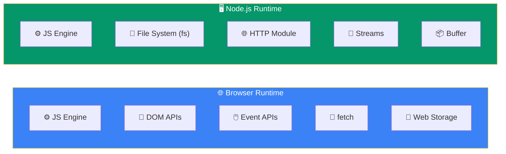

# JavaScript Runtime

> The **engine** runs your code. The **runtime** gives it superpowers.

## Why Do We Need This?

JavaScript by itself can only do basic math and string operations. The **Runtime Environment** provides all the powerful features you actually use:
- `console.log()` to print things
- `document.querySelector()` to interact with HTML
- `fetch()` to call APIs
- `setTimeout()` to delay execution
- `localStorage` to save data

## Real World Example

```javascript
// This code uses features from the Runtime, NOT the engine:
console.log("Hello");           // console API
setTimeout(() => {}, 1000);     // timer API
fetch("/api/data");             // HTTP API
document.querySelector("div");   // DOM API
```

The JavaScript engine (V8) only handles the core language. Everything else comes from the **runtime**.

## Visual Explanation

```mermaid
flowchart TD
    subgraph Runtime["🌐 JavaScript Runtime (Browser)"]
        subgraph Engine["⚙️ JavaScript Engine (V8)"]
            E1["📦 Memory Heap"]
            E2["📋 Call Stack"]
        end
        
        subgraph WebAPIs["🌍 Web APIs (Browser-provided)"]
            W1["📍 DOM APIs"]
            W2["⏱️ setTimeout/setInterval"]
            W3["📡 fetch / AJAX"]
            W4["💾 localStorage"]
            W5["🗺️ Geolocation"]
            W6["🎵 Audio/Video"]
        end
        
        subgraph Queues["📥 Callback Queues"]
            Q1["🔴 MacroTask Queue<br/>(setTimeout, events)"]
            Q2["🟢 MicroTask Queue<br/>(Promises, observers)"]
        end
        
        subgraph Loop["🔄 Event Loop"]
            L1["📋 Check Call Stack"]
            L2["📤 Push from Queue"]
        end
        
        Engine <--> WebAPIs
        WebAPIs --> Queues
        Queues <--> Loop
        Loop --> Engine
    end
    
    style Engine fill:#f0db4f,color:#000
    style WebAPIs fill:#3b82f6,color:#fff
    style Loop fill:#7c3aed,color:#fff
```



## Browser Runtime vs Node.js Runtime



## Detailed Breakdown

### What's in the Engine?

| Component | Role |
|-----------|------|
| **Memory Heap** | Where objects, arrays, and functions are stored |
| **Call Stack** | Where function calls are tracked (LIFO) |

### What's in the Browser Runtime?

| API Category | Examples |
|-------------|----------|
| **DOM** | `document.getElementById()`, `element.innerHTML` |
| **Events** | `addEventListener()`, `onclick`, `onsubmit` |
| **Timers** | `setTimeout()`, `setInterval()` |
| **Network** | `fetch()`, `XMLHttpRequest` |
| **Storage** | `localStorage`, `sessionStorage`, `IndexedDB` |
| **Console** | `console.log()`, `console.table()` |
| **Media** | `Audio`, `Video`, `canvas`, `WebGL` |
| **Device** | `Geolocation`, `Battery`, `Camera` |

### What's in the Node.js Runtime?

| Module | Used For |
|--------|----------|
| `fs` | File system read/write |
| `http` | Create web servers |
| `path` | File path utilities |
| `os` | Operating system info |
| `crypto` | Encryption/hashing |
| `stream` | Streaming data |

## 💡 Did You Know?

> `console.log()` is NOT part of JavaScript. It's a **Web API** provided by the runtime. That's why `console` doesn't exist if you try to run JavaScript outside a runtime!

```javascript
// Try this in a blank HTML file (no runtime):
console.log("Hello"); // Works in browser → runtime provides console

// But if you try to use Node.js-specific APIs in the browser:
// require('fs');     // ❌ ReferenceError: fs is not defined
```

## 🚀 Best Practices

- Know **where** your code will run (browser vs Node.js)
- Don't use Node.js-specific APIs in browser code
- Use feature detection for cross-browser APIs:
  ```javascript
  if (typeof localStorage !== "undefined") {
    localStorage.setItem("key", "value");
  }
  ```
- The Event Loop ensures non-blocking behavior — never block it

## 🎯 Interview Tip

> **Q:** "What's the difference between a JavaScript Engine and a Runtime?"
> **A:** "The **engine** executes JS code (parsing, compiling, garbage collection). The **runtime** includes the engine PLUS all the APIs (DOM, fetch, timers, etc.) and the event loop infrastructure. The engine is the car's engine; the runtime is the whole car."

## ✅ Summary

- **Engine** = core language execution (V8, SpiderMonkey)
- **Runtime** = Engine + APIs + Event Loop + Queues
- Browser runtime provides DOM, events, fetch, storage
- Node.js runtime provides file system, HTTP, streams
- Always check where your code will run

## 🔗 Related Topics

- [JavaScript Engines](../01-introduction/javascript-engines) — The heart of the runtime
- [Event Loop](../phase-03-asynchronous-javascript/event-loop) — How async works

---

> 💡 **Remember:** When you write JavaScript, you're always writing for a specific runtime. Browser JS ≠ Node.js JS.
