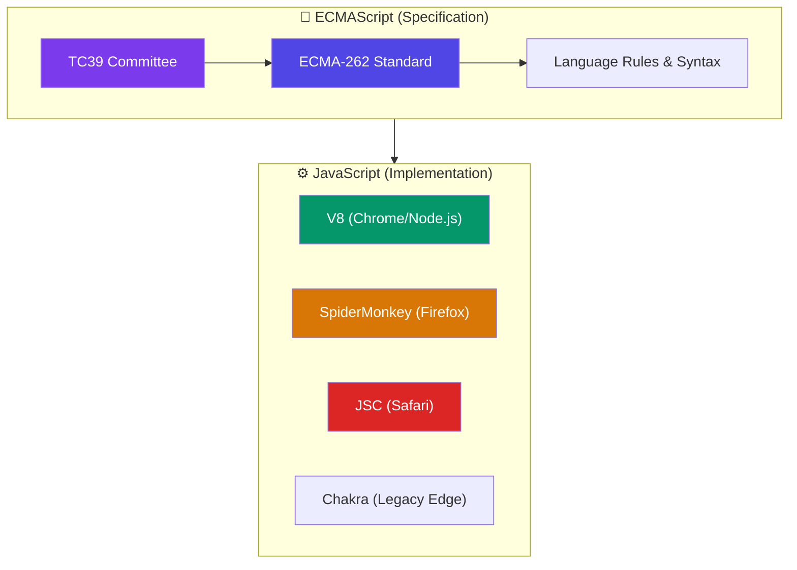
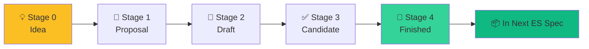

# JavaScript vs ECMAScript

> Think of **ECMAScript** as the Constitution, and **JavaScript** as the law passed by a specific government (browser/Node.js) that implements it.

## Why Do We Need This?

Many developers use "JavaScript" and "ECMAScript" interchangeably, but they're different things. Understanding this distinction helps you:
- Know **which features** are available in different environments
- Understand **TC39** (the committee that evolves JavaScript)
- Follow **proposals** and future language features
- Set up transpilers (Babel) properly

## Visual Explanation



## Detailed Explanation

| Term | What it is | Maintained by |
|------|------------|---------------|
| **ECMAScript** | The **specification** — the official document that defines the language rules, syntax, and semantics | ECMA International (TC39 committee) |
| **JavaScript** | The **implementation** — the programming language that runs in browsers and Node.js, based on the ECMAScript spec | Various vendors (Google, Mozilla, Apple, Microsoft) |

### The Relationship

```
ECMAScript (spec) → JavaScript (implementation of the spec)
                  → JScript (Microsoft's old implementation)
                  → ActionScript (Adobe's implementation)
                  → Node.js (server-side implementation)
```

> 💡 **Did You Know?** The name "JavaScript" is trademarked by Oracle. That's why the official standard is called "ECMAScript" — not "JavaScript Standard."

## The TC39 Process

New JavaScript features go through a **5-stage process** before becoming part of the spec:



| Stage | Description | Example |
|-------|-------------|---------|
| 0 | Someone has an idea | "Let's add pattern matching" |
| 1 | Formal proposal, API discussed | `proposal-pattern-matching` |
| 2 | Draft with syntax and semantics | Spec text written |
| 3 | Browser prototypes, feedback | Chrome ships behind a flag |
| 4 | Tested, accepted, ready | Part of next ECMAScript release |

## ECMAScript Versions Quick Reference

```mermaid
flowchart LR
    ES3["ES3<br/>(1999)"] --> ES5["ES5<br/>(2009)"]
    ES5 --> ES6["ES6/ES2015<br/>Biggest update"]
    ES6 --> ES2016["ES2016"]
    ES2016 --> ES2017["ES2017"]
    ES2017 --> ES2018["ES2018"]
    ES2018 --> ES2019["ES2019"]
    ES2019 --> ES2020["ES2020"]
    ES2020 --> ES2021["ES2021"]
    ES2021 --> ES2022["ES2022"]
    ES2022 --> ES2023["ES2023"]
    ES2023 --> ES2024["ES2024"]
    
    style ES3 fill:#d1d5db
    style ES6 fill:#fbbf24
    style ES2024 fill:#34d399
```



## 🎯 Interview Tip

> **Q:** "What's the difference between JavaScript and ECMAScript?"
> **A:** "ECMAScript is the **specification** — the rules and standards defined by ECMA International. JavaScript is the **implementation** of that specification that runs in browsers and Node.js. Think of it like a blueprint (spec) vs. the actual building (implementation)."

## ⚠ Common Mistake

```javascript
// ❌ Saying "ECMAScript 6 features" when you mean "ES2015 features"
// Both are correct, but ES2015 is the official name

// ✅ Modern convention uses the year: ES2015, ES2020, ES2024
```

## ✅ Summary

- **ECMAScript** = the specification (the what)
- **JavaScript** = the implementation (the how)
- TC39 committee governs the spec
- New features go through 5 stages before inclusion
- Annual release cycle since 2015

## 🔗 Related Topics

- [JavaScript Engines](./javascript-engines) — Who implements the spec
- [Compilation vs Interpretation](./compilation-vs-interpretation) — How engines run the code

---

> 💡 **Key Insight:** When you hear "ES6+" or "ES2024", it refers to the ECMAScript specification version. Modern JavaScript is essentially "ECMAScript + browser APIs + Node.js APIs."
