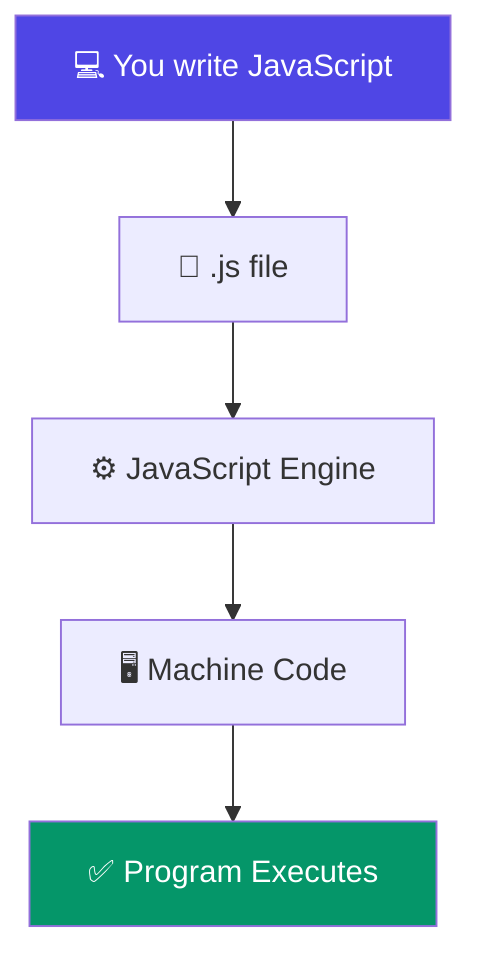

# What is JavaScript?

> **JavaScript** is a high-level, interpreted (or JIT-compiled) programming language that powers the modern web. It's the only language that runs natively in every web browser.

## Why Do We Need JavaScript?

In the early days of the web (1990s), web pages were **static** — plain text and images with no interactivity. JavaScript was created to bring **life** to the web: form validation, animations, interactive maps, real-time updates, and full-blown applications like Google Docs and Figma.

Today, JavaScript is everywhere:
- **Browsers** — Every website you visit
- **Servers** — Node.js, Deno, Bun
- **Mobile apps** — React Native, Ionic
- **Desktop apps** — VS Code, Slack, Discord (built with Electron)
- **IoT devices** — Smart TVs, robots

## Real World Story

> **"Write once, run anywhere"** — Java promised this in the 90s. But JavaScript actually delivered it, just differently: **Write once, run in every browser**.

When Brendan Eich created JavaScript in 1995, he couldn't have imagined that 30 years later:
- NASA uses JavaScript for mission-critical dashboards
- Netflix streams videos powered by Node.js
- Tesla uses JavaScript in their infotainment systems

## Real World Example

```javascript
// This simple code runs everywhere — browser, server, phone, even smartwatch
function greetUser(name) {
  return `👋 Welcome to the web, ${name}!`;
}

console.log(greetUser("Alice")); // 👋 Welcome to the web, Alice!
```

## Visual Explanation



## Detailed Explanation

JavaScript is a **multi-paradigm** language, which means it supports:

| Paradigm | What it means | Example |
|----------|---------------|---------|
| **Object-Oriented** | Organize code using objects and classes | `class Car {}` |
| **Functional** | Use functions as building blocks | `arr.map(x => x * 2)` |
| **Imperative** | Write step-by-step instructions | `if (x > 5) { ... }` |
| **Event-Driven** | React to user actions | `button.onclick = handler` |

## Key Characteristics

| Feature | Explanation |
|---------|-------------|
| 🧵 **Single-threaded** | One thing at a time (but non-blocking via event loop) |
| 🔄 **Dynamic typing** | Variable types are determined at runtime |
| 🗑 **Garbage-collected** | Automatic memory management |
| 🧩 **Prototype-based** | Objects inherit from other objects (not classes) |
| 📜 **Interpreted / JIT** | Compiled just-in-time for performance |

## Syntax Overview

```javascript
// Comments: Single-line or /* multi-line */

// Variables
let name = "Alice";        // can change
const PI = 3.14;           // constant

// Data types
42           // number
"hello"      // string
true         // boolean
null         // intentional empty
undefined    // not yet assigned

// Functions
function add(a, b) {
  return a + b;
}

// Objects & Arrays
const user = { name: "Alice", age: 30 };
const nums = [1, 2, 3, 4, 5];

// Control flow
if (age >= 18) {
  console.log("Adult");
} else {
  console.log("Minor");
}
```

## 💡 Did You Know?

> JavaScript was created in **just 10 days** by Brendan Eich in May 1995. It was originally called **Mocha**, then **LiveScript**, before being renamed to **JavaScript** for marketing reasons.

## 🚀 Best Practices

- Always use `===` instead of `==` for comparisons
- Prefer `const` over `let`; never use `var` in modern code
- Use meaningful variable names
- Add semicolons (optional but safe)
- Enable strict mode: `"use strict"`

## 📦 Browser Support

JavaScript is supported by **100% of all web browsers** — Chrome, Firefox, Safari, Edge, and even old browsers. It's the most universally supported programming language in history.

## 🎯 Interview Tip

> **Common question:** "Is JavaScript compiled or interpreted?"
> **Answer:** Modern JavaScript uses **JIT (Just-In-Time) compilation** — a hybrid approach. The engine parses → interprets to bytecode → compiles hot code paths to machine code.

## ✅ Summary

- JavaScript is the language of the web — runs in every browser
- Multi-paradigm: OOP, functional, event-driven
- Single-threaded but non-blocking (thanks to the event loop)
- Fast, flexible, and universally supported

## 🔗 What's Next?

- [History of JavaScript](./history-of-javascript) — How it all began
- [JavaScript vs ECMAScript](./javascript-vs-ecmascript) — The spec vs the implementation

---

> 💡 **Remember:** JavaScript is NOT the same as Java. They just share a name for marketing reasons!
