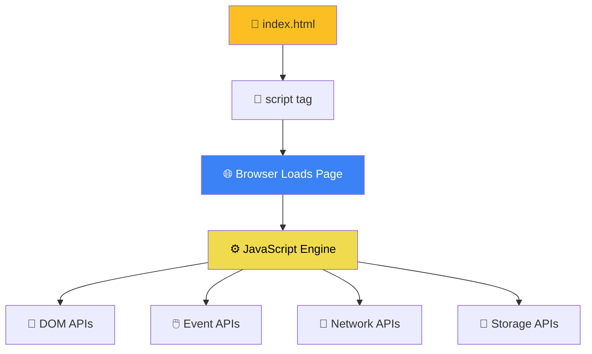

# Browser Environment

> Every web browser is a complete JavaScript runtime environment.

## Visual Explanation



## Running JavaScript in the Browser

**Method 1: Inline in HTML**
```html
<!DOCTYPE html>
<html>
<body>
  <button onclick="alert('Hello!')">Click Me</button>
  <script>
    console.log("This runs when the page loads");
  </script>
</body>
</html>
```

**Method 2: External file (recommended)**
```html
<!DOCTYPE html>
<html>
<body>
  <script src="app.js"></script>
</body>
</html>
```

## The Browser Console

Press `F12` or `Ctrl+Shift+I` (Cmd+Option+I on Mac) to open DevTools, then click "Console":

```javascript
// Try these in the browser console:
console.log("Hello from the browser!");
console.warn("This is a warning");
console.error("This is an error");

// You can run ANY JavaScript in the console
const name = prompt("What's your name?");
alert(`Hello, ${name}!`);
```
