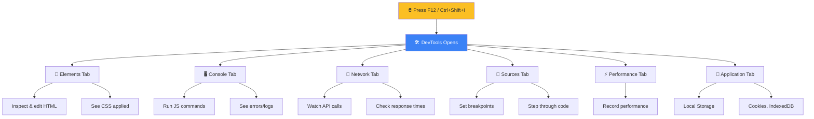

# Developer Tools

> Browser DevTools (F12) are your #1 tool for JavaScript development.

## DevTools Overview



## Setting Breakpoints

```javascript
// app.js — add this and open DevTools → Sources → app.js
function calculateTotal(items) {
  let total = 0;
  for (const item of items) {
    total += item.price * item.quantity;
    debugger; // Pauses execution here (like a breakpoint)
  }
  return total;
}

const cart = [
  { name: "Shoes", price: 50, quantity: 2 },
  { name: "Shirt", price: 30, quantity: 1 },
];

console.log(calculateTotal(cart));
```

## 🚀 DevTools Power Tips

| Action | How |
|--------|-----|
| **Console autocomplete** | Start typing → suggestions appear |
| **$0** | Last inspected element |
| **console.table()** | Print arrays/objects as table |
| **Monitor events** | `monitorEvents(element)` |
| **Copy from console** | Right-click → "Copy object" |
| **$() shorthand** | `$("div")` = `document.querySelector("div")` |
| **$$() shorthand** | `$$("div")` = `document.querySelectorAll("div")` |
