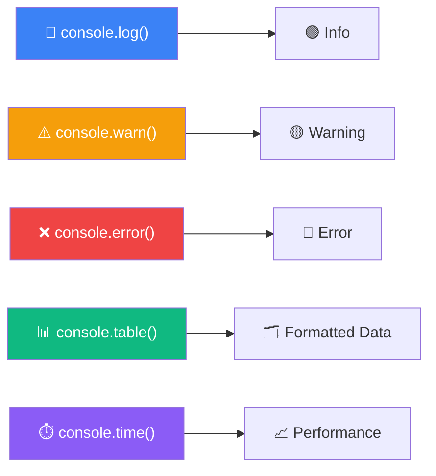

# JavaScript Console

> The console is your best friend for debugging JavaScript.

## Common Console Methods

```javascript
// Basic logging
console.log("Simple message");
console.log("Value:", 42);
console.log("Multiple", "args", "work", "too");

// Different levels
console.info("Information message");
console.warn("⚠️ Warning — something is off");
console.error("❌ Error — something broke");

// Logging data structures
const user = { name: "Alice", age: 30, city: "Mumbai" };
console.log(user);       // Expandable object
console.table(user);     // Table view

const users = [
  { name: "Alice", age: 30 },
  { name: "Bob", age: 25 },
  { name: "Charlie", age: 35 }
];
console.table(users);    // Beautiful table!

// Timing code
console.time("loop");
for (let i = 0; i < 1000000; i++) {}
console.timeEnd("loop");  // loop: 2.34ms

// Stack trace
function inner() {
  console.trace("Where was I called from?");
}
function outer() {
  inner();
}
outer();
// Prints full call stack!
```

## Visual Explanation


