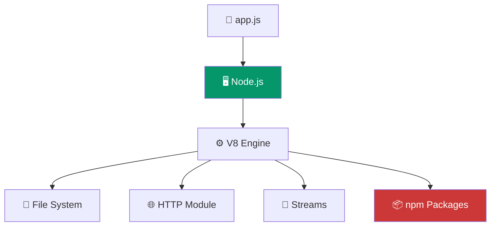

# Node.js Environment

> Node.js lets you run JavaScript **outside the browser** — on servers, desktops, and IoT devices.

## Visual Explanation



## Installation

1. Go to [nodejs.org](https://nodejs.org)
2. Download the LTS version
3. Run the installer
4. Verify:

```bash
node --version   # e.g., v22.x.x
npm --version    # e.g., 10.x.x
```

## Running JavaScript with Node.js

```bash
# Run a file
node app.js

# Open the REPL (interactive shell)
node
> console.log("Hello from Node.js!")
> .exit
```

## Example

```javascript
// app.js — server-side JavaScript
const fs = require("fs");

fs.writeFileSync("hello.txt", "Hello from Node.js!");
console.log("File created!");
```

```bash
node app.js
# File created!
# Check your directory — hello.txt exists!
```
