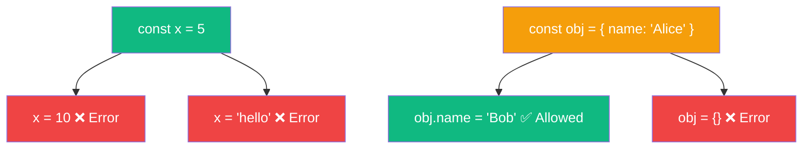

# `const`

> `const` creates a **constant binding** — once assigned, the variable name can't be reassigned.

## Why Do We Need This?

`const` protects you from accidentally changing important values. It also signals to other developers: "this value should not change."

## Key Rule

```javascript
const PI = 3.14;
PI = 3.14159; // ❌ TypeError: Assignment to constant variable
```

> **Important:** `const` does NOT make the value immutable. Only the **binding** is constant.

```javascript
const user = { name: "Alice" };
user.name = "Bob"; // ✅ This is ALLOWED!
user = {};         // ❌ TypeError — can't reassign
```

## Visual Explanation



## Code Examples

```javascript
// 1. Must initialize
// const x; // ❌ SyntaxError: Missing initializer

// 2. When to use const
const API_URL = "https://api.example.com";
const MAX_RETRIES = 3;
const USER_ROLES = { admin: "Admin", user: "User" };

// 3. const with objects — can mutate properties
const person = { name: "Alice", age: 30 };
person.age = 31;      // ✅ Allowed
person.city = "NYC";  // ✅ Allowed
// person = {};       // ❌ Error

// 4. const with arrays — can mutate contents
const numbers = [1, 2, 3];
numbers.push(4);      // ✅ Allowed
numbers[0] = 10;      // ✅ Allowed
// numbers = [];     // ❌ Error

// 5. const in loops — works with for...of
const items = [1, 2, 3];
for (const item of items) {
  console.log(item); // ✅ Allowed — new binding per iteration
}
```

## 🚀 Best Practices

- **Default to `const`** — use it for everything by default
- Only change to `let` when you need reassignment
- Use `Object.freeze()` for truly immutable objects:

```javascript
const config = Object.freeze({
  apiUrl: "https://api.example.com",
  timeout: 5000,
});
config.timeout = 10000; // ❌ Fails silently (or TypeError in strict mode)
```

## ✅ Summary

| Feature | `const` |
|---------|---------|
| Reassign | ❌ Error |
| Mutation | ✅ Allowed |
| Hoisting | ✅ (TDZ) |
| Must initialize | ✅ Yes |
| Modern usage | ✅ Default choice |
