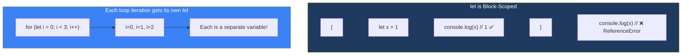

# `let`

> `let` is the **modern replacement** for `var`. It fixes `var`'s biggest problems: function scoping and accidental redeclaration.

## Why Do We Need This?

`let` was introduced in ES6 (2015) to solve the problems that plagued `var` for 20 years:
- Block scoping instead of function scoping
- No accidental redeclaration
- Temporal Dead Zone prevents accessing before initialization

## Visual Explanation



## Key Characteristics

| Feature | Behavior |
|---------|----------|
| **Scope** | Block-scoped (inside `{}`) |
| **Hoisting** | Yes, but **in TDZ** until initialized |
| **Redeclaration** | ❌ Not allowed in same scope |
| **Global property** | ❌ Does NOT attach to `window` |
| **Temporal Dead Zone** | ✅ Access before declaration throws |

## Code Examples

```javascript
// 1. Block-scoped — does NOT leak
{
  let secret = "Hidden";
  console.log(secret); // "Hidden"
}
console.log(secret); // ❌ ReferenceError

// 2. No redeclaration
let count = 1;
let count = 2; // ❌ SyntaxError: Identifier 'count' has already been declared

// 3. TDZ — can't access before declaration
console.log(x); // ❌ ReferenceError: Cannot access 'x' before initialization
let x = 5;

// 4. No window property
let globalLet = "not on window";
console.log(window.globalLet); // undefined (browser)

// 5. Loop behavior — each iteration gets its own binding
for (let i = 0; i < 3; i++) {
  setTimeout(() => console.log(i), 100);
}
// Output: 0, 1, 2 ✅ (each callback gets its own i)
```

## 🚀 Best Practices

- Use `let` when you need to **reassign** a variable
- Prefer `const` by default — only use `let` when you must
- Declare all `let` variables at the **top of their block**

## ✅ Summary

| Feature | `let` |
|---------|-------|
| Scope | Block |
| Hoisting | ✅ (but TDZ) |
| Redeclare | ❌ Error |
| Window property | ❌ No |
| Modern usage | ✅ Yes (when reassignment needed) |
