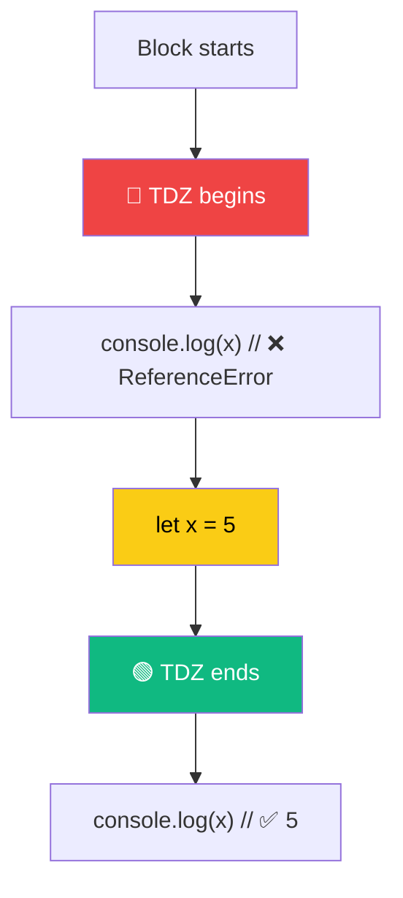

# Temporal Dead Zone (TDZ)

> The **Temporal Dead Zone** is the time between when a variable enters scope and when it's actually initialized.

## Why Do We Need This?

TDZ prevents you from accessing variables before they're declared — catching a common programming mistake. With `var`, accessing before declaration gave `undefined` silently. With TDZ, you get a clear error.

## Visual Explanation



## Code Examples

```javascript
// TDZ with let
{
  // TDZ starts
  // console.log(x); // ❌ ReferenceError: Cannot access 'x' before initialization
  let x = 5;        // TDZ ends
  console.log(x);   // ✅ 5
}

// TDZ with const — same behavior
{
  // console.log(y); // ❌ ReferenceError
  const y = 10;
  console.log(y);   // ✅ 10
}

// NO TDZ with var
{
  console.log(z);   // undefined — no TDZ
  var z = 20;
}

// typeof is NOT safe in TDZ!
{
  // console.log(typeof x); // ❌ ReferenceError (unlike var!)
  let x = 5;
}
```

## 🎯 Interview Tip

> **Q:** "What is the Temporal Dead Zone and why was it introduced?"
> **A:** "TDZ is the period between entering scope and variable initialization where `let` and `const` are hoisted but uninitialized. It was introduced to catch bugs early — accessing a variable before its declaration is almost always a mistake."
