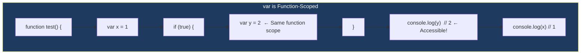

# `var`

> `var` is the **old way** to declare variables. It's still widely used in legacy code, but modern JavaScript prefers `let` and `const`.

## Why Do We Need This?

Many codebases still use `var`. Understanding it is essential for:
- Maintaining **legacy code**
- Understanding **why** `let` and `const` were created
- Passing **interview questions** about hoisting and scope

## Real World Example

```javascript
// Old codebase from 2010 — everything was var
var userName = "Alice";
var userAge = 30;
var isAdmin = true;
```

## Visual Explanation



## Key Characteristics

| Feature | Behavior |
|---------|----------|
| **Scope** | Function-scoped (not block-scoped!) |
| **Hoisting** | Hoisted, initialized as `undefined` |
| **Redeclaration** | ✅ Allowed |
| **Global property** | Becomes property of `window` (browser) |
| **Block scope** | ❌ Ignores `{}` blocks |

## Code Examples

```javascript
// 1. Function-scoped — NOT block-scoped
function example() {
  if (true) {
    var message = "Hello"; // var ignores block
  }
  console.log(message); // "Hello" — accessible!
}
example();

// Compare with let:
function example2() {
  if (true) {
    let message = "Hello"; // let respects block
  }
  console.log(message); // ❌ ReferenceError
}

// 2. Hoisting
console.log(x); // undefined (not an error!)
var x = 5;

// This is how JavaScript sees it:
// var x;           ← hoisted (initialized as undefined)
// console.log(x);  ← undefined
// x = 5;           ← assignment stays

// 3. Redeclaration is allowed
var count = 1;
var count = 2; // ✅ No error
console.log(count); // 2

// 4. Global scope — attaches to window
var globalVar = "I'm global";
console.log(window.globalVar); // "I'm global" (browser)
```

## The Classic `var` Bug

```javascript
// This is the #1 reason var is avoided:
for (var i = 0; i < 3; i++) {
  setTimeout(() => console.log(i), 100);
}
// Output: 3, 3, 3 (NOT 0, 1, 2!)
// Reason: var is function-scoped, so there's only ONE `i`

// Fix with let:
for (let i = 0; i < 3; i++) {
  setTimeout(() => console.log(i), 100);
}
// Output: 0, 1, 2 ✅
```

## ⚠ Common Mistakes

```javascript
// ❌ Assuming var is block-scoped
{
  var x = 10;
}
console.log(x); // 10 ← leaks out of block!

// ❌ Redeclaring accidentally
var apiKey = "prod-123";
// ... 100 lines later ...
var apiKey = "dev-456"; // No error! Bug introduced silently
```

## 🚀 Best Practices

- **Never use `var` in modern code** — use `let` or `const`
- Understand `var` for legacy code maintenance
- If you see `var` in code reviews, suggest replacing with `let`/`const`

## 🎯 Interview Tip

> **Q:** "What happens when you use `var` inside a `for` loop with `setTimeout`?"
> **A:** "All callbacks share the same `var` variable because `var` is function-scoped. By the time the callbacks run, the loop has finished and `i` is at its final value. Using `let` fixes this because `let` is block-scoped and creates a new binding for each iteration."

## ✅ Summary

| Feature | `var` |
|---------|-------|
| Scope | Function |
| Hoisting | ✅ (initialized as `undefined`) |
| Redeclare | ✅ Allowed |
| Window property | ✅ `window.x` |
| Modern usage | ❌ Avoid |

## 🔗 Related Topics

- [let](./let) — The modern alternative
- [const](./const) — Constant declarations
- [Temporal Dead Zone](./temporal-dead-zone) — Why `let`/`const` behave differently
