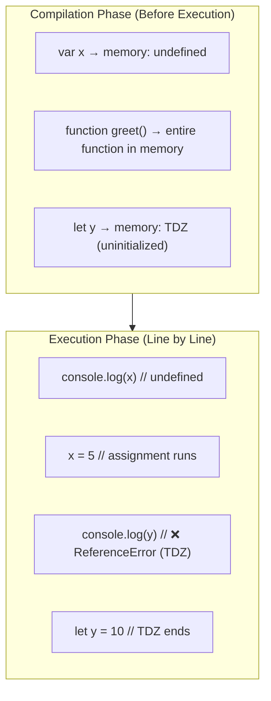

# Variable Hoisting

> **Hoisting** is JavaScript's behavior of moving declarations to the top of their scope before code execution.

## Visual Explanation



## Hoisting Behavior by Declaration Type

```javascript
// 1. var — hoisted, initialized as undefined
console.log(a); // undefined
var a = 5;

// 2. let — hoisted, but in TDZ (uninitialized)
console.log(b); // ❌ ReferenceError
let b = 10;

// 3. const — same as let (hoisted, TDZ)
console.log(c); // ❌ ReferenceError
const c = 15;

// 4. Function declarations — fully hoisted
greet(); // "Hello!" — entire function is hoisted
function greet() {
  console.log("Hello!");
}

// 5. Function expressions — only variable hoisted
// sayHi(); // ❌ TypeError: sayHi is not a function
var sayHi = function() {
  console.log("Hi!");
};
```

## 🎯 Interview Tip

> **Q:** "Are `let` and `const` hoisted?"
> **A:** "Yes! They are hoisted, but they're placed in the **Temporal Dead Zone**. Unlike `var`, they are NOT initialized with `undefined`. This is why accessing them before declaration throws a `ReferenceError` instead of returning `undefined`."
