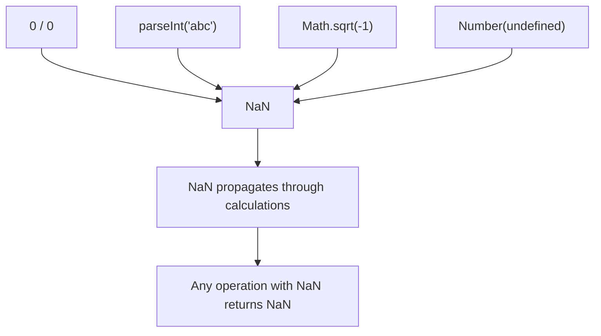

# NaN (Not a Number)

## Introduction

`NaN` is a special numeric value representing the result of an **invalid or undefined mathematical operation**. Despite its name, `typeof NaN` is `'number'`.

## Why Do We Need This?

NaN appears when calculations fail. Knowing how to detect and handle NaN prevents silent bugs from propagating through your code.

## Real World Story

NaN is like a corrupted measurement. The reading says "Not a Measurement" but it's still in the measurement column. If you don't check for it, your averages will be wrong.

## Visual Explanation



## How NaN Occurs

```javascript
0 / 0;                // NaN
parseInt('abc');      // NaN
Math.sqrt(-1);        // NaN
Number(undefined);    // NaN
NaN + 5;              // NaN — propagates!
```

## The Unique Property

`NaN` is the **only value** in JavaScript that is not equal to itself:

```javascript
NaN === NaN;  // false — unique!
NaN == NaN;   // false
```

## Checking for NaN

```javascript
// ✅ Correct
Number.isNaN(NaN);    // true
Number.isNaN('abc');  // false — doesn't coerce
Number.isNaN(NaN + 5); // true

// ❌ Wrong — coerces first
isNaN('abc');  // true — because Number('abc') is NaN
isNaN('123');  // false

// ✅ Alternative
function isValueNaN(value) {
  return typeof value === 'number' && isNaN(value);
}
```

## Best Practices

- Always use `Number.isNaN()` instead of global `isNaN()`
- Validate numeric inputs before performing operations
- Use fallback values for failed calculations

## Summary

- `NaN` is a number type representing invalid math
- `NaN !== NaN` — it's not equal to itself
- Use `Number.isNaN()` for reliable checking
- NaN propagates through all arithmetic operations

## Further Reading

- [MDN: NaN](https://developer.mozilla.org/en-US/docs/Web/JavaScript/Reference/Global_Objects/NaN)
- [MDN: Number.isNaN](https://developer.mozilla.org/en-US/docs/Web/JavaScript/Reference/Global_Objects/Number/isNaN)
