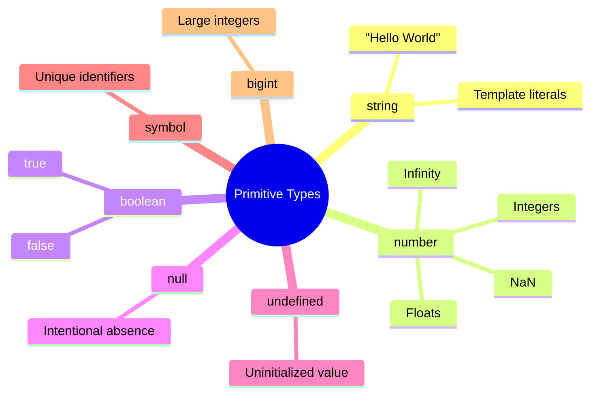
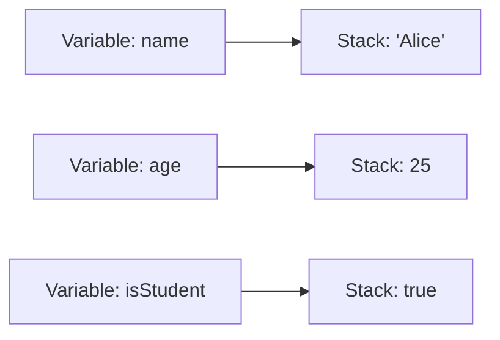

# Primitive Types

## Introduction

Primitive types are the most basic data types in JavaScript. They are **immutable** and **stored by value**. JavaScript has 7 primitive types.

## Why Do We Need This?

Primitives are the building blocks of all data in JavaScript. Understanding them helps you write predictable code and avoid subtle bugs.

## Real World Story

Think of primitives like ingredients in a kitchen. A **string** is like a label, a **number** is like a measurement, and a **boolean** is like a yes/no answer. You can't change the ingredient itself — you use it to create something new.

## Real World Example

```javascript
// Primitives are like individual LEGO bricks
let name = "Alice";     // string — a label
let age = 25;           // number — a quantity
let isStudent = true;   // boolean — yes/no
```

## Visual Explanation



## Detailed Explanation

### 1. **string** — Text data

```javascript
let single = 'Hello';
let double = "World";
let template = `Hello ${double}`;
```

Strings are sequences of characters. They are **immutable** — you cannot change a character in place.

### 2. **number** — Numeric data

```javascript
let integer = 42;
let float = 3.14;
let negative = -10;
let infinity = Infinity;
let notANumber = NaN;
```

Numbers are **IEEE 754 double-precision** (64-bit). All numbers are floating-point internally.

### 3. **boolean** — Logical values

```javascript
let isTrue = true;
let isFalse = false;
```

Used in conditions, comparisons, and logical operations.

### 4. **null** — Intentional absence

```javascript
let empty = null;
```

`null` is explicitly assigned. It means "nothing" or "empty".

### 5. **undefined** — Uninitialized value

```javascript
let notAssigned;
console.log(notAssigned); // undefined
```

A variable that is declared but not assigned gets `undefined` by default.

### 6. **symbol** — Unique identifier

```javascript
const sym1 = Symbol('id');
const sym2 = Symbol('id');
console.log(sym1 === sym2); // false — each symbol is unique
```

Symbols are used for object property keys that should not conflict.

### 7. **bigint** — Large integers

```javascript
const big = 1234567890123456789012345678901234567890n;
```

`bigint` can represent integers larger than `2^53 - 1`.

## Step-by-Step Breakdown

1. A primitive value is stored **directly** in the variable
2. When you assign a primitive to another variable, the **value is copied**
3. When you pass a primitive to a function, it's passed **by value**
4. Primitives are **immutable** — operations return new values

## Internal Working



Primitives live in the **stack** memory. They are small, fixed-size values.

## Advantages

- ✅ Fast to create and access
- ✅ Immutable — no side effects
- ✅ Predictable behavior
- ✅ Memory efficient

## Disadvantages

- ❌ Fixed-size limitation (except bigint)
- ❌ No methods on primitives (JavaScript auto-boxes them temporarily)

## Best Practices

- Use `const` for primitives that don't change
- Use `null` to explicitly clear a value
- Prefer `===` over `==` for comparisons
- Use `Number()` for explicit conversion

## Common Mistakes

```javascript
// ❌ Wrong
console.log(0.1 + 0.2 === 0.3); // false — floating point precision

// ✅ Right
console.log(Math.abs(0.1 + 0.2 - 0.3) < Number.EPSILON);
```

## Performance Notes

- Primitives are faster than objects
- String concatenation creates new strings (memory cost)
- Use template literals for complex strings

## Browser Support

All primitives are supported in all modern browsers. `bigint` is supported in Chrome 67+, Firefox 68+, Safari 14+.

## Interview Questions

**Q:** What is the difference between `null` and `undefined`?
**A:** `null` is an explicitly assigned empty value, while `undefined` means a variable has been declared but not assigned a value.

**Q:** Why is `0.1 + 0.2 !== 0.3`?
**A:** Floating-point arithmetic uses binary representation. 0.1 and 0.2 cannot be represented exactly in binary, leading to small rounding errors.

## Coding Challenge

```javascript
// Write a function that checks if a value is a primitive type
function isPrimitive(value) {
  // Your code here
}
```

## Summary

- JavaScript has 7 primitive types: string, number, boolean, null, undefined, symbol, bigint
- Primitives are immutable and stored by value
- Use `typeof` to check primitive types (except `null`)
- Primitives are the foundation for all JavaScript data

## Further Reading

- [MDN: JavaScript Data Types](https://developer.mozilla.org/en-US/docs/Web/JavaScript/Data_structures)
- [MDN: typeof](https://developer.mozilla.org/en-US/docs/Web/JavaScript/Reference/Operators/typeof)
