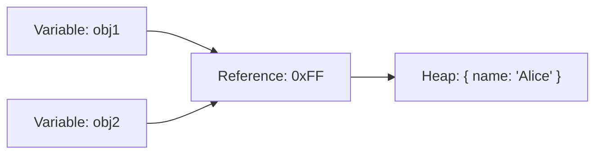
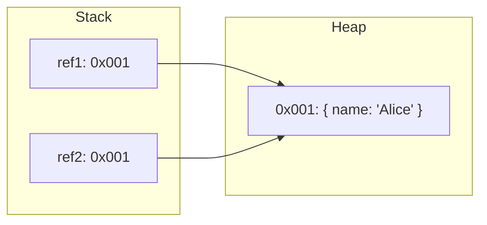

# Reference Types

## Introduction

Reference types store **references** (memory addresses) to values. Unlike primitives, they are **mutable** and stored in the **heap**. Objects, arrays, and functions are all reference types.

## Why Do We Need This?

Reference types allow us to build complex data structures. Without them, we couldn't create arrays, objects, or reusable functions.

## Real World Story

A reference type is like a house address. Multiple people can have the same address, and if someone renovates the house, everyone sees the change. Primitives are like a photograph — each copy is independent.

## Visual Explanation



Both `obj1` and `obj2` point to the same object in memory.

## Detailed Explanation

### Objects

```javascript
const person = {
  name: 'Alice',
  age: 25
};
```

### Arrays

```javascript
const numbers = [1, 2, 3];
```

### Functions

```javascript
function greet(name) {
  return `Hello, ${name}`;
}
```

## Pass by Reference

```javascript
function updateName(obj) {
  obj.name = 'Bob';
}

const user = { name: 'Alice' };
updateName(user);
console.log(user.name); // 'Bob' — modified!
```

## Internal Working



## Best Practices

- Use `Object.freeze()` to make objects immutable
- Create copies using spread (`...`) or `Object.assign()`
- Be careful when passing objects to functions

## Common Mistakes

```javascript
const obj1 = { value: 1 };
const obj2 = obj1;
obj2.value = 2;
console.log(obj1.value); // 2 — unexpected mutation!
```

## Summary

- Reference types store memory addresses
- Objects, arrays, and functions are reference types
- Passed by reference — mutations affect all references

## Further Reading

- [MDN: Object](https://developer.mozilla.org/en-US/docs/Web/JavaScript/Reference/Global_Objects/Object)
