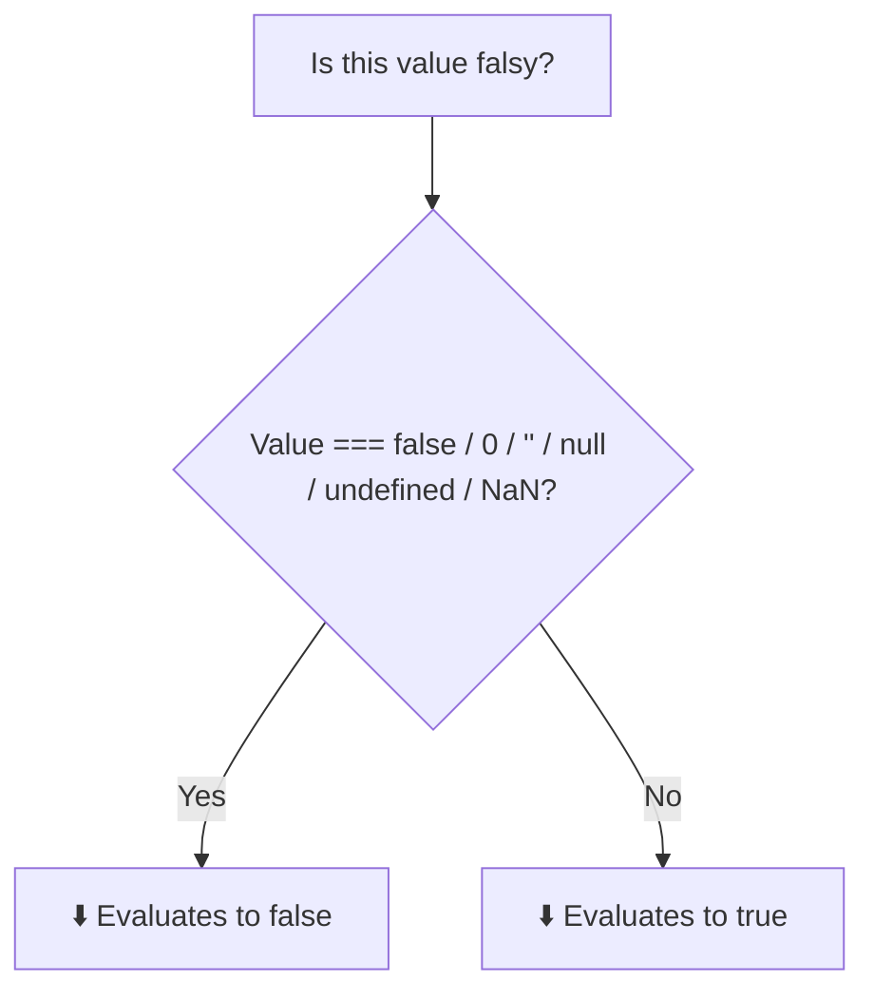

# Truthy & Falsy Values

## Introduction

In JavaScript, every value has an inherent boolean "truthiness" — it's either **truthy** (evaluates to `true` in a boolean context) or **falsy** (evaluates to `false`).

## Why Do We Need This?

Truthy/falsy checks are used everywhere: `if` statements, logical operators `&&`/`||`, and ternary expressions. Understanding them is key to writing clean conditional logic.

## Falsy Values

There are exactly **6 falsy values** in JavaScript:

```javascript
false;        // the boolean false
0;            // zero
'';           // empty string
null;         // null
undefined;    // undefined
NaN;          // Not a Number
```

## Truthy Values

Everything else is truthy:

```javascript
true;
1;              // any non-zero number
'hello';        // any non-empty string
[];             // empty array
{};             // empty object
function(){};   // any function
'false';        // the string "false" — truthy!
```

## Visual Explanation



## Practical Usage

```javascript
// Default values with ||
const name = userInput || 'Guest';
// If userInput is falsy (empty, null, undefined), use 'Guest'

// Guard with &&
isLoggedIn && renderDashboard();
// Only render if isLoggedIn is truthy
```

## Common Mistakes

```javascript
// ❌ Wrong
if (value == false) { } // Too broad — catches 0 and ''

// ✅ Right
if (value === false) { } // Only actual false

// ❌ Wrong — 0 is falsy
if (score) { } // Fails when score is 0

// ✅ Right
if (score !== null && score !== undefined) { }
```

## Summary

- Only 6 falsy values: `false`, `0`, `''`, `null`, `undefined`, `NaN`
- Everything else is truthy
- Use `!!` to check truthiness: `!!value`
- Be careful with `0` — it's falsy but often a valid value

## Further Reading

- [MDN: Falsy](https://developer.mozilla.org/en-US/docs/Glossary/Falsy)
- [MDN: Truthy](https://developer.mozilla.org/en-US/docs/Glossary/Truthy)
