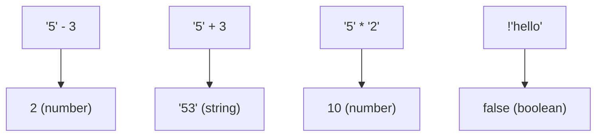

# Type Coercion

## Introduction

Type coercion is JavaScript's **implicit** type conversion — when JavaScript automatically converts a value to another type during operations.

## Why Do We Need This?

Coercion happens everywhere in JavaScript. Understanding it is essential to avoid bugs that seem like magic.

## Real World Story

Coercion is like a restaurant that adapts your order. You ask for "2" beers (string), and the waiter brings 2 beers (number). It's convenient, but sometimes you get something unexpected.

## Visual Explanation



## Common Coercion Patterns

```javascript
// String coercion with +
'5' + 3;     // '53'
'5' + true;  // '5true'
'5' + null;  // '5null'

// Number coercion with -, *, /
'5' - 3;     // 2
'10' * '2';  // 20
'10' / '2';  // 5

// Boolean coercion
if ('hello') {}  // truthy
if (0) {}        // falsy
!'hello';        // false
!!'hello';       // true
```

## Loose Equality (==)

```javascript
5 == '5';     // true
0 == false;   // true
'' == false;  // true
null == undefined; // true
```

## Best Practices

- Use `===` and `!==` instead of `==` and `!=`
- Be explicit with conversions — don't rely on coercion
- Use `Number.isNaN()` instead of global `isNaN()`

## Common Mistakes

```javascript
[] == false;  // true — surprising!
[] == ![];    // true — the famous JavaScript wtf
```

## Summary

- Coercion is implicit type conversion
- `+` prefers string concatenation
- `-`, `*`, `/` prefer numeric conversion
- Always use `===` to avoid coercion surprises

## Further Reading

- [MDN: Type Coercion](https://developer.mozilla.org/en-US/docs/Glossary/Type_coercion)
- [JavaScript Weird Parts — Coercion](https://www.youtube.com/watch?v=ET8wD5h1lRQ)
