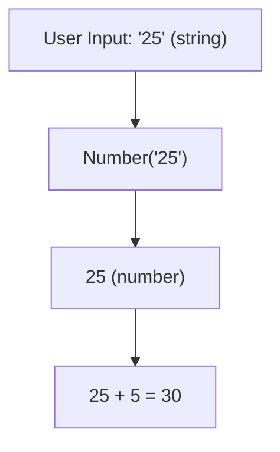

# Type Conversion

## Introduction

Type conversion is the **explicit** transformation of a value from one type to another using built-in functions like `String()`, `Number()`, and `Boolean()`.

## Why Do We Need This?

User input comes as strings, API responses need parsing, and calculations require numbers. Type conversion bridges these gaps.

## Real World Story

Think of type conversion like a universal adapter for electronics. You have a US plug (string) that needs to fit into a European socket (number). The adapter (conversion function) transforms it.

## Visual Explanation



## String Conversion

```javascript
String(123);       // "123"
String(true);      // "true"
String(null);      // "null"
String(undefined); // "undefined"
String([1,2,3]);   // "1,2,3"
```

## Number Conversion

```javascript
Number("123");     // 123
Number("12.5");    // 12.5
Number("abc");     // NaN
Number(true);      // 1
Number(false);     // 0
Number(null);      // 0
Number(undefined); // NaN
```

## Boolean Conversion

```javascript
Boolean(1);        // true
Boolean(0);        // false
Boolean("hello");  // true
Boolean("");       // false
Boolean(null);     // false
Boolean(undefined);// false
```

## Best Practices

- Always use explicit conversion — avoid relying on coercion
- Validate conversions, especially with user input
- Use `parseInt()` and `parseFloat()` for string parsing

## Common Mistakes

```javascript
Number("123abc"); // NaN — not 123!
parseInt("123abc"); // 123 — more forgiving
```

## Summary

- Use `String()`, `Number()`, `Boolean()` for explicit conversion
- Always prefer explicit over implicit (coercion)
- Validate numeric conversions for user input

## Further Reading

- [MDN: Type Conversion](https://developer.mozilla.org/en-US/docs/Glossary/Type_Conversion)
