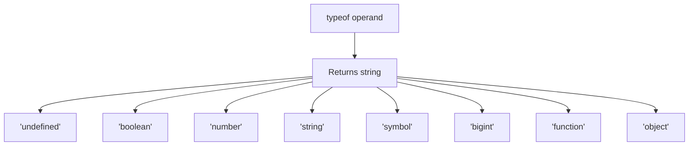

# typeof Operator

## Introduction

The `typeof` operator returns a string indicating the type of the operand. It's the most common way to check types at runtime.

## Why Do We Need This?

Type checking is essential for validation, debugging, and writing type-safe code — especially since JavaScript is dynamically typed.

## Visual Explanation



## Syntax

```javascript
typeof operand;
typeof(operand); // function-like syntax
```

## Return Values

```javascript
typeof undefined;     // 'undefined'
typeof true;          // 'boolean'
typeof 42;            // 'number'
typeof 'hello';       // 'string'
typeof 123n;          // 'bigint'
typeof Symbol();      // 'symbol'
typeof function(){};  // 'function'
typeof {};            // 'object'
typeof [];            // 'object'
typeof null;          // 'object' — infamous bug!
```

## The typeof null Bug

```javascript
typeof null; // 'object' — this is a bug from JavaScript's first release
// To check for null:
value === null; // use strict equality
```

## Practical Usage

```javascript
function add(a, b) {
  if (typeof a !== 'number' || typeof b !== 'number') {
    throw new Error('Both arguments must be numbers');
  }
  return a + b;
}
```

## Summary

- `typeof` returns a string indicating the type
- `typeof null` returns `'object'` (historical bug)
- Arrays return `'object'` — use `Array.isArray()` instead

## Further Reading

- [MDN: typeof](https://developer.mozilla.org/en-US/docs/Web/JavaScript/Reference/Operators/typeof)
