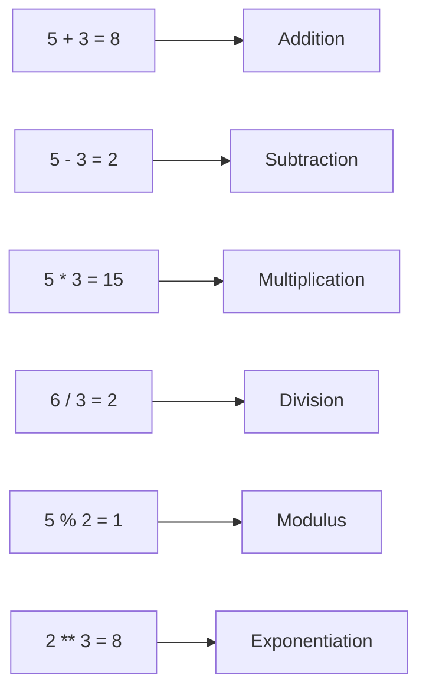

# Arithmetic Operators

## Introduction

Arithmetic operators perform mathematical calculations on numeric values.

## Visual Explanation



## Operators

```javascript
let a = 10, b = 3;

a + b;  // 13 — addition
a - b;  // 7  — subtraction
a * b;  // 30 — multiplication
a / b;  // 3.3333 — division
a % b;  // 1  — modulus (remainder)
a ** b; // 1000 — exponentiation (ES7)
```

## Increment & Decrement

```javascript
let count = 5;

count++; // 5 (post-increment) → count = 6
++count; // 7 (pre-increment)
count--; // 7 (post-decrement) → count = 6
--count; // 5 (pre-decrement)
```

## Operator Precedence

```javascript
2 + 3 * 4;   // 14 — multiplication first
(2 + 3) * 4; // 20 — parentheses override
```

## Summary

- Arithmetic operators work with numbers
- `+` also concatenates strings
- `%` gives remainder
- `**` is for exponentiation (ES7)

## Further Reading

- [MDN: Arithmetic Operators](https://developer.mozilla.org/en-US/docs/Web/JavaScript/Reference/Operators/Arithmetic_operators)
