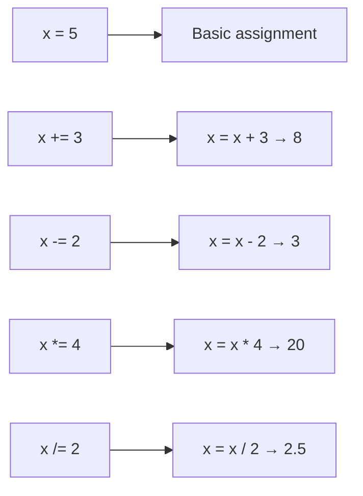

# Assignment Operators

## Introduction

Assignment operators assign values to variables. The basic `=` operator is extended by compound assignment operators that combine assignment with arithmetic.

## Visual Explanation



## Operators

```javascript
let x = 10;

x += 5;   // x = x + 5 → 15
x -= 3;   // x = x - 3 → 12
x *= 2;   // x = x * 2 → 24
x /= 4;   // x = x / 4 → 6
x %= 4;   // x = x % 4 → 2
x **= 3;  // x = x ** 3 → 8
```

## Summary

- `=` assigns a value
- Compound operators combine operation with assignment
- They make code concise and readable

## Further Reading

- [MDN: Assignment Operators](https://developer.mozilla.org/en-US/docs/Web/JavaScript/Reference/Operators/Assignment_operators)
