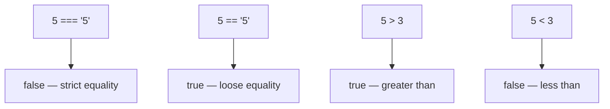

# Comparison Operators

## Introduction

Comparison operators compare two values and return a boolean (`true` or `false`). They are fundamental to decision-making in code.

## Visual Explanation



## Strict vs Loose Equality

```javascript
// Strict (recommended) — checks value AND type
5 === 5;    // true
5 === '5';  // false — different types
5 !== '5';  // true

// Loose (avoid) — coerces types
5 == '5';   // true — coercive comparison
5 != '5';   // false
```

## Relational Operators

```javascript
5 > 3;    // true
5 >= 5;   // true
3 < 5;    // true
3 <= 5;   // true
```

## String Comparison

```javascript
'apple' < 'banana';  // true — lexicographic order
'Apple' < 'apple';   // true — uppercase < lowercase
```

## Best Practices

- Always use `===` and `!==` instead of `==` and `!=`
- Be careful with floating-point comparisons
- Use `Object.is()` for `NaN` comparisons

## Summary

- `===` checks value and type (strict)
- `==` checks value with coercion (loose)
- Always prefer `===`
- Relational operators work on numbers and strings

## Further Reading

- [MDN: Comparison Operators](https://developer.mozilla.org/en-US/docs/Web/JavaScript/Reference/Operators/Comparison_operators)
