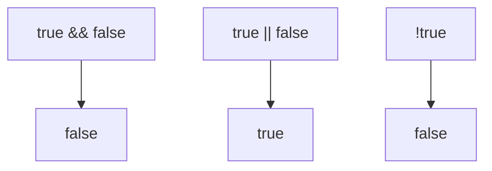

# Logical Operators

## Introduction

Logical operators work with boolean values and use **short-circuit evaluation**. They are essential for conditionally executing code.

## Visual Explanation



## AND (&&)

Returns the first falsy value or the last truthy value:

```javascript
true && true;     // true
true && false;    // false
0 && 'hello';     // 0

// Short-circuit — if first is falsy, second is NOT evaluated
false && console.log('never runs');
```

## OR (||)

Returns the first truthy value or the last falsy value:

```javascript
true || false;    // true
false || 'hello'; // 'hello'
0 || null;        // null

// Short-circuit — if first is truthy, second is NOT evaluated
true || console.log('never runs');
```

## NOT (!)

```javascript
!true;    // false
!false;   // true
!0;       // true — 0 is falsy
!'hello'; // false — 'hello' is truthy
!!'hello'; // true — double NOT converts to boolean
```

## Common Patterns

```javascript
// Default values (with ||)
const name = userInput || 'Guest';

// Guard (with &&)
isLoggedIn && renderDashboard();

// Toggle
isActive = !isActive;
```

## Best Practices

- Use `||` for defaults (but beware of falsy values like `0` or `''`)
- Use `??` (nullish coalescing) when only `null`/`undefined` should trigger defaults
- Use `&&` for conditional execution

## Summary

- `&&` returns first falsy or last truthy
- `||` returns first truthy or last falsy
- `!` inverts boolean value
- Both `&&` and `||` short-circuit

## Further Reading

- [MDN: Logical Operators](https://developer.mozilla.org/en-US/docs/Web/JavaScript/Reference/Operators/Logical_operators)
