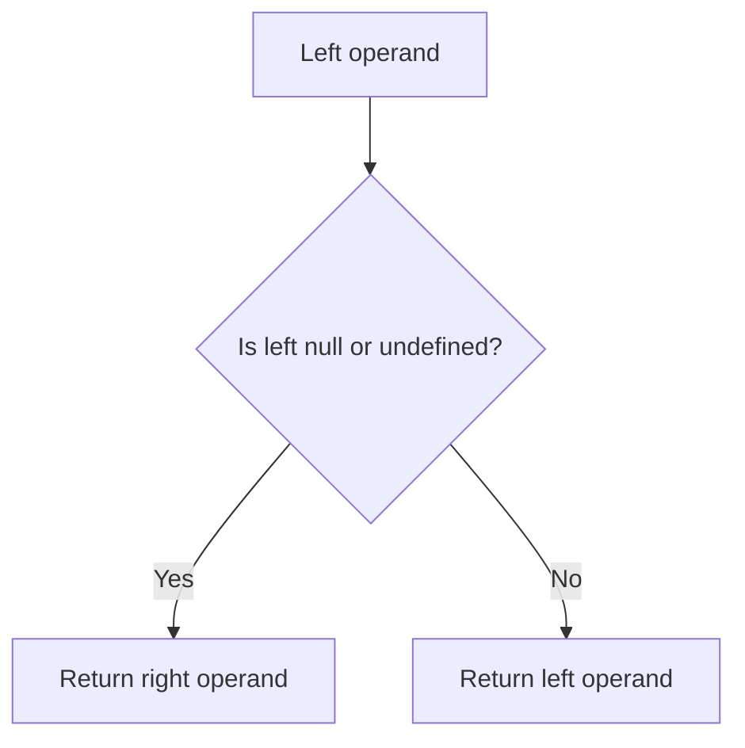

# Nullish Coalescing Operator (??)

## Introduction

The nullish coalescing operator `??` returns the right-hand operand only when the left-hand operand is `null` or `undefined`. Unlike `||`, it doesn't treat `0`, `''`, or `false` as falsy.

## Why Do We Need This?

The `||` operator treats `0`, `''`, and `false` as falsy and replaces them with the default. But sometimes these are valid values — `??` solves this problem.

```javascript
const count = 0;
count || 10;    // 10 — wrong! 0 is valid
count ?? 10;    // 0 — correct
```

## Visual Explanation



## Examples

```javascript
null ?? 'default';      // 'default'
undefined ?? 'default'; // 'default'
0 ?? 'default';         // 0 — preserved!
'' ?? 'default';        // '' — preserved!
false ?? 'default';     // false — preserved!
```

## Cannot Chain with && or ||

```javascript
null || undefined ?? 'default'; // SyntaxError!
// Use parentheses:
(null || undefined) ?? 'default'; // 'default'
```

## Summary

- `??` checks for `null`/`undefined` only
- Use instead of `||` when `0`, `''`, `false` are valid values
- Cannot mix with `&&` or `||` without parentheses

## Further Reading

- [MDN: Nullish Coalescing](https://developer.mozilla.org/en-US/docs/Web/JavaScript/Reference/Operators/Nullish_coalescing)
