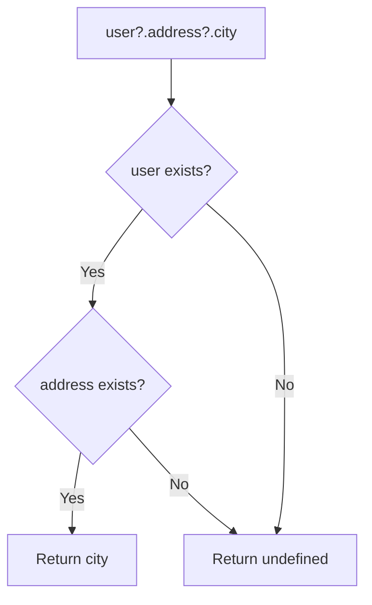

# Optional Chaining (?.)

## Introduction

Optional chaining `?.` allows you to safely access deeply nested object properties without throwing an error if an intermediate property is `null` or `undefined`.

## Why Do We Need This?

Before optional chaining, accessing nested properties required verbose checks:

```javascript
// Before
const city = user && user.address && user.address.city;

// After
const city = user?.address?.city;
```

## Visual Explanation



## Examples

```javascript
const user = {
  name: 'Alice',
  address: null
};

user?.name;              // 'Alice'
user?.address?.city;     // undefined — no error!
user?.profile?.age;      // undefined — no error!
```

## Method Calls

```javascript
const obj = {
  greet: () => 'Hello'
};

obj.greet?.();     // 'Hello'
obj.farewell?.();  // undefined — no error
```

## Summary

- `?.` safely accesses nested properties
- Returns `undefined` if intermediate value is `null`/`undefined`
- Also works with method calls: `obj.method?.()`
- Prevents "Cannot read property of undefined" errors

## Further Reading

- [MDN: Optional Chaining](https://developer.mozilla.org/en-US/docs/Web/JavaScript/Reference/Operators/Optional_chaining)
