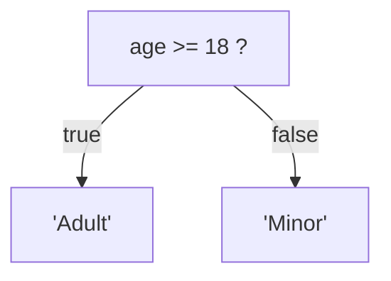

# Ternary Operator (Conditional Operator)

## Introduction

The ternary operator is a shorthand for `if-else` statements. It takes three operands and returns one of two values based on a condition.

## Syntax

```javascript
condition ? expressionIfTrue : expressionIfFalse;
```

## Example

```javascript
const age = 20;
const status = age >= 18 ? 'Adult' : 'Minor';
// status: 'Adult'
```

## Visual Explanation



## Chaining

```javascript
const score = 85;
const grade = score >= 90 ? 'A' 
            : score >= 80 ? 'B' 
            : score >= 70 ? 'C' 
            : 'F';
// grade: 'B'
```

## Best Practices

- Use for simple conditional assignments
- Avoid deeply nested ternary operators (max 2 levels)
- Use `if-else` for complex logic

## Summary

- Shorthand for `if-else`
- Returns a value, so it can be used in expressions
- Keep it simple and readable

## Further Reading

- [MDN: Conditional Operator](https://developer.mozilla.org/en-US/docs/Web/JavaScript/Reference/Operators/Conditional_operator)
