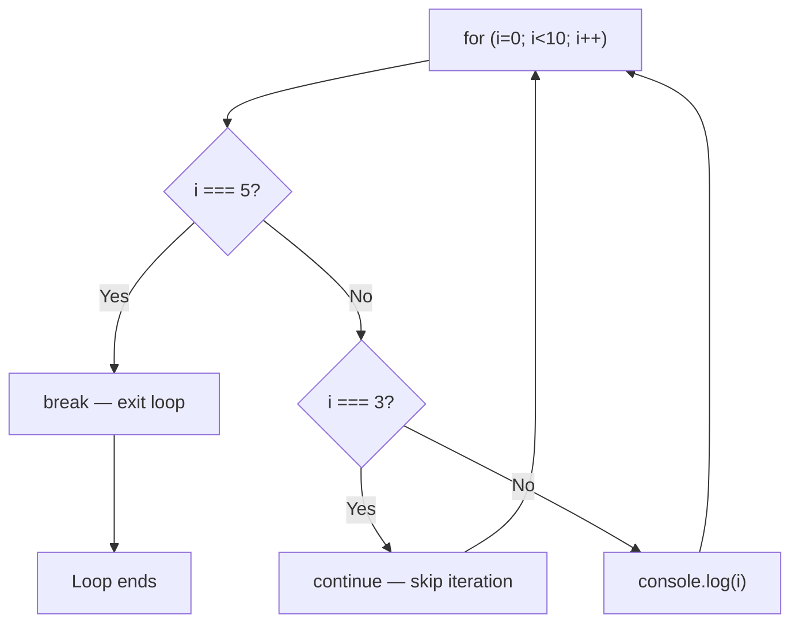

# break and continue

## Introduction

`break` exits a loop entirely. `continue` skips the current iteration and moves to the next one.

## Visual Explanation



## break

```javascript
for (let i = 0; i < 10; i++) {
  if (i === 5) break;
  console.log(i); // 0, 1, 2, 3, 4
}
// Loop stops when i reaches 5
```

## continue

```javascript
for (let i = 0; i < 5; i++) {
  if (i === 2) continue;
  console.log(i); // 0, 1, 3, 4
}
// Skips i = 2
```

## Use Cases

```javascript
// break — finding an element
const numbers = [1, 2, 3, 4, 5];
let found = null;
for (const n of numbers) {
  if (n === 3) {
    found = n;
    break; // stop searching
  }
}

// continue — filtering in a loop
for (let i = 0; i < 10; i++) {
  if (i % 2 === 0) continue; // skip evens
  console.log(i); // 1, 3, 5, 7, 9
}
```

## Summary

- `break` exits the loop immediately
- `continue` skips to the next iteration
- Use `break` for search/find patterns
- Use `continue` to skip unwanted values

## Further Reading

- [MDN: break](https://developer.mozilla.org/en-US/docs/Web/JavaScript/Reference/Statements/break)
- [MDN: continue](https://developer.mozilla.org/en-US/docs/Web/JavaScript/Reference/Statements/continue)
