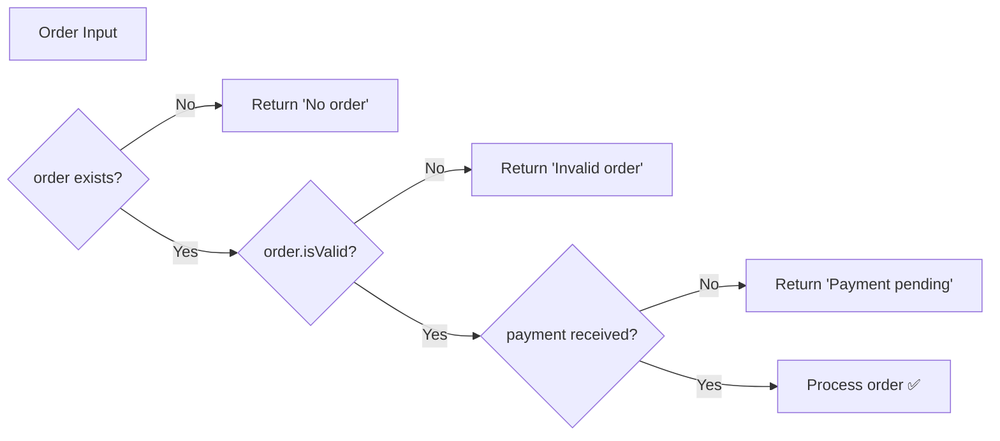

# Guard Clauses

## Introduction

Guard clauses (early returns) exit a function at the top when certain conditions aren't met, avoiding deeply nested `if` statements.

## Why Do We Need This?

Deeply nested code is hard to read and maintain. Guard clauses flatten the logic and make error/edge-case handling clear at the top.

## Before — Deep Nesting

```javascript
function processOrder(order) {
  if (order) {
    if (order.isValid) {
      if (order.paymentReceived) {
        // process order...
        return 'Order processed';
      } else {
        return 'Payment pending';
      }
    } else {
      return 'Invalid order';
    }
  } else {
    return 'No order';
  }
}
```

## After — Guard Clauses

```javascript
function processOrder(order) {
  if (!order) return 'No order';
  if (!order.isValid) return 'Invalid order';
  if (!order.paymentReceived) return 'Payment pending';

  // process order...
  return 'Order processed';
}
```

## Visual Explanation



## Best Practices

- Place guard clauses at the top of functions
- Each guard handles one edge case
- The main logic stays at the bottom, un-nested
- Guards improve readability and reduce cognitive load

## Summary

- Guard clauses return early when conditions aren't met
- They flatten nested code
- They make error handling obvious
- Main logic stays clean at the bottom
