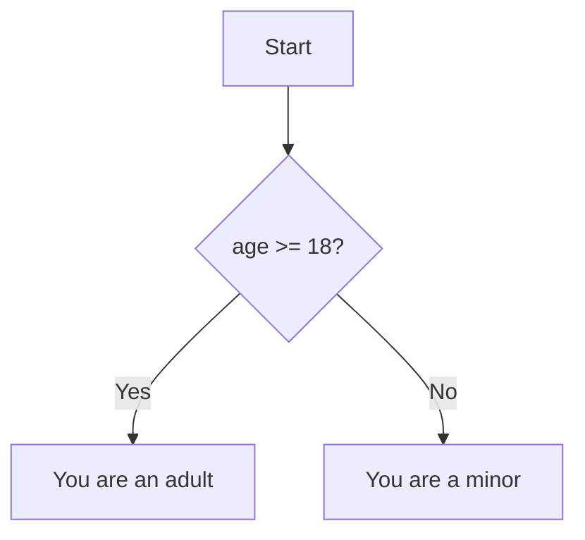

# if-else

## Introduction

The `if` statement executes a block of code if a condition is truthy. `else if` and `else` provide alternative branches.

## Syntax

```javascript
if (condition) {
  // runs if condition is truthy
} else if (otherCondition) {
  // runs if first condition is falsy and otherCondition is truthy
} else {
  // runs if all conditions are falsy
}
```

## Visual Explanation



## Examples

```javascript
const age = 20;

if (age >= 18) {
  console.log('You can vote');
} else if (age >= 16) {
  console.log('You can drive');
} else {
  console.log('Too young');
}
```

## Truthiness in Conditions

```javascript
if ('hello') { }     // runs — truthy
if (0) { }            // doesn't run — falsy
if (null) { }         // doesn't run — falsy
if ([]) { }           // runs — truthy (empty array)
if ({}) { }           // runs — truthy (empty object)
```

## Best Practices

- Always use `===` for comparisons (not `==`)
- Prefer `switch` for many conditions on the same value
- Use guard clauses to avoid deep nesting

## Further Reading

- [MDN: if-else](https://developer.mozilla.org/en-US/docs/Web/JavaScript/Reference/Statements/if...else)
