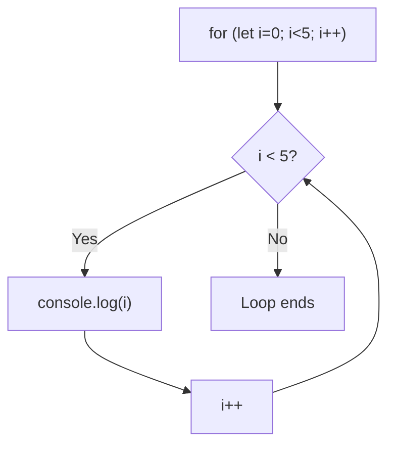

# Loops

## Introduction

Loops repeat a block of code until a condition is met. JavaScript has several loop types: `for`, `while`, and `do-while`.

## for Loop

```javascript
for (initialization; condition; increment) {
  // body
}

for (let i = 0; i < 5; i++) {
  console.log(i); // 0, 1, 2, 3, 4
}
```

## while Loop

```javascript
let i = 0;
while (i < 5) {
  console.log(i); // 0, 1, 2, 3, 4
  i++;
}
```

## do-while Loop

```javascript
let i = 0;
do {
  console.log(i); // 0, 1, 2, 3, 4
  i++;
} while (i < 5);
```

## Visual Explanation



## Loop Comparison

| Loop | Use Case | Condition Check |
|------|----------|----------------|
| `for` | Known number of iterations | Before each iteration |
| `while` | Unknown iterations | Before each iteration |
| `do-while` | Must run at least once | After each iteration |

## Iterating Arrays

```javascript
const fruits = ['apple', 'banana', 'orange'];

// Classic for
for (let i = 0; i < fruits.length; i++) {
  console.log(fruits[i]);
}

// for...of (ES6)
for (const fruit of fruits) {
  console.log(fruit);
}

// forEach
fruits.forEach(fruit => console.log(fruit));
```

## Summary

- `for` — known iteration count
- `while` — unknown count, checked before
- `do-while` — runs at least once
- Prefer `for...of` for arrays (ES6)

## Further Reading

- [MDN: Loops](https://developer.mozilla.org/en-US/docs/Web/JavaScript/Guide/Loops_and_iteration)
