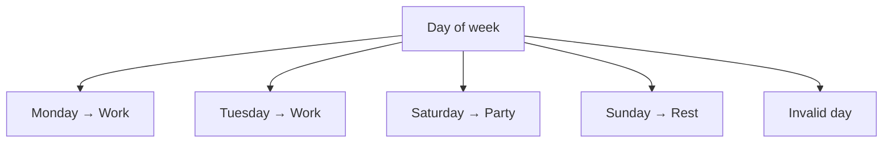

# switch

## Introduction

The `switch` statement evaluates an expression and executes code based on matching cases. It's cleaner than multiple `if-else` chains when comparing the same value.

## Syntax

```javascript
switch (expression) {
  case value1:
    // runs if expression === value1
    break;
  case value2:
    // runs if expression === value2
    break;
  default:
    // runs if no case matches
}
```

## Visual Explanation



## Example

```javascript
const day = 3;

switch (day) {
  case 1:
    console.log('Monday');
    break;
  case 2:
    console.log('Tuesday');
    break;
  case 3:
    console.log('Wednesday');
    break;
  default:
    console.log('Invalid day');
}
```

## Fall-Through

```javascript
switch (day) {
  case 1:
  case 2:
  case 3:
  case 4:
  case 5:
    console.log('Weekday');
    break;
  case 6:
  case 7:
    console.log('Weekend');
    break;
}
```

## Summary

- Use `switch` for multiple conditions on the same value
- Always include `break` unless you want fall-through
- `default` handles no-match cases

## Further Reading

- [MDN: switch](https://developer.mozilla.org/en-US/docs/Web/JavaScript/Reference/Statements/switch)
