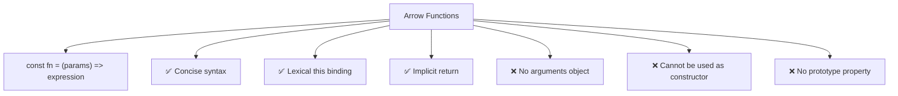

# Arrow Functions

## Introduction

Arrow functions provide a **concise syntax** for writing functions. They also have a special behavior with the `this` keyword — they inherit `this` from the surrounding scope (lexical `this`).

## Syntax

```javascript
// Basic
const add = (a, b) => a + b;

// With block body
const add = (a, b) => {
  return a + b;
};

// Single parameter — parentheses optional
const square = x => x * x;

// No parameters
const greet = () => 'Hello!';
```

## Visual Explanation



## Examples

```javascript
// Implicit return
const double = x => x * 2;

// With block body (explicit return needed)
const sum = (a, b) => {
  const result = a + b;
  return result;
};

// Returning an object literal
const createUser = (name, age) => ({ name, age });
```

## Lexical `this`

```javascript
const obj = {
  name: 'Alice',
  greet: function() {
    setTimeout(() => {
      console.log(this.name); // 'Alice' — arrow inherits this
    }, 100);
  }
};
```

## Summary

- Concise syntax with implicit return
- Lexical `this` — inherits from surrounding scope
- No `arguments` object, no `new` usage
- Perfect for callbacks and array methods

## Further Reading

- [MDN: Arrow Functions](https://developer.mozilla.org/en-US/docs/Web/JavaScript/Reference/Functions/Arrow_functions)
