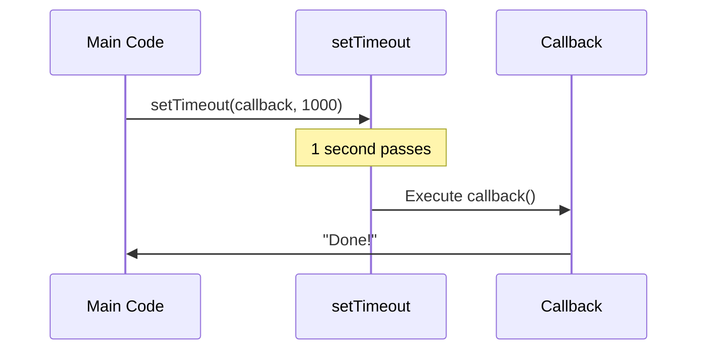

# Callback Functions

## Introduction

A callback is a function passed as an **argument to another function** to be executed later. Callbacks are fundamental to asynchronous JavaScript.

## Why Do We Need This?

JavaScript is single-threaded. Callbacks allow you to run code after an operation completes (like a network request, file read, or timer).

## Visual Explanation



## Example

```javascript
function fetchData(callback) {
  setTimeout(() => {
    callback('Data received');
  }, 1000);
}

fetchData((message) => {
  console.log(message); // 'Data received' (after 1 second)
});
```

## Array Methods with Callbacks

```javascript
const numbers = [1, 2, 3, 4, 5];

numbers.forEach(n => console.log(n));
const doubled = numbers.map(n => n * 2);
const evens = numbers.filter(n => n % 2 === 0);
const sum = numbers.reduce((acc, n) => acc + n, 0);
```

## Common Patterns

```javascript
// Error-first callbacks (Node.js style)
function readFile(path, callback) {
  // ... read file
  if (error) {
    callback(error, null);
  } else {
    callback(null, data);
  }
}

readFile('/path/to/file', (err, data) => {
  if (err) return console.error(err);
  console.log(data);
});
```

## Summary

- Callbacks are functions passed as arguments
- They are executed after an operation completes
- Used in async patterns, event handlers, and array methods

## Further Reading

- [MDN: Callback Function](https://developer.mozilla.org/en-US/docs/Glossary/Callback_function)
