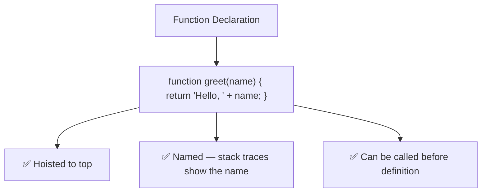

# Function Declaration

## Introduction

A function declaration defines a named function using the `function` keyword. It is **hoisted** — meaning it can be called before its definition in the code.

## Syntax

```javascript
function functionName(parameters) {
  // body
  return value;
}
```

## Example

```javascript
function greet(name) {
  return `Hello, ${name}!`;
}

console.log(greet('Alice')); // 'Hello, Alice!'
```

## Hoisting

Function declarations are hoisted to the top of their scope:

```javascript
// ✅ This works!
sayHello(); // 'Hello!'

function sayHello() {
  console.log('Hello!');
}
```

## Visual Explanation



## Best Practices

- Use function declarations for top-level functions
- Name your functions descriptively (verb + noun)
- Keep functions small and focused (single responsibility)

## Common Mistakes

```javascript
// ❌ Don't declare inside if/else (block scoping issues)
if (condition) {
  function doSomething() { } // problematic
}
```

## Summary

- Function declarations are hoisted
- They create named functions
- Use for main program functions

## Further Reading

- [MDN: Function Declaration](https://developer.mozilla.org/en-US/docs/Web/JavaScript/Reference/Statements/function)
