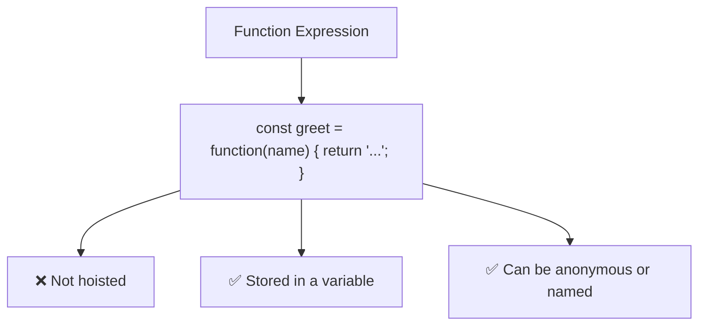

# Function Expression

## Introduction

A function expression assigns a function to a variable. Unlike declarations, function expressions are **not hoisted**.

## Syntax

```javascript
const functionName = function(parameters) {
  // body
};
```

## Example

```javascript
const greet = function(name) {
  return `Hello, ${name}!`;
};

console.log(greet('Alice')); // 'Hello, Alice!'
```

## Not Hoisted

```javascript
// ❌ This throws an error!
sayHello(); // ReferenceError

const sayHello = function() {
  console.log('Hello!');
};
```

## Visual Explanation



## Named Function Expressions

```javascript
const greet = function sayHello(name) {
  return `Hello, ${name}!`;
};
// The name 'sayHello' is only accessible inside the function
```

## When to Use

- Assigning functions conditionally
- Passing as callbacks
- Creating functions inside blocks
- Used as IIFE (Immediately Invoked Function Expression)

## Summary

- Function expressions are NOT hoisted
- They are assigned to variables
- Useful for callbacks and conditional assignments

## Further Reading

- [MDN: Function Expression](https://developer.mozilla.org/en-US/docs/Web/JavaScript/Reference/Operators/function)
