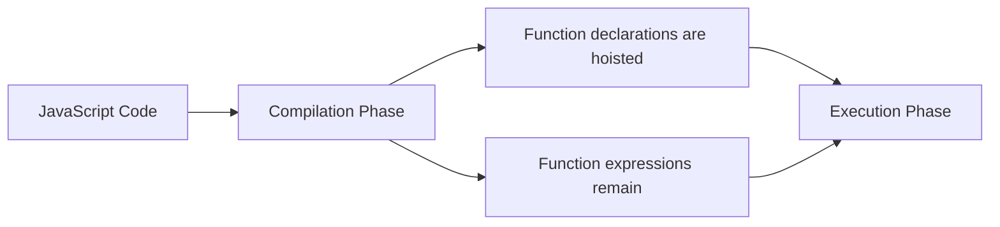
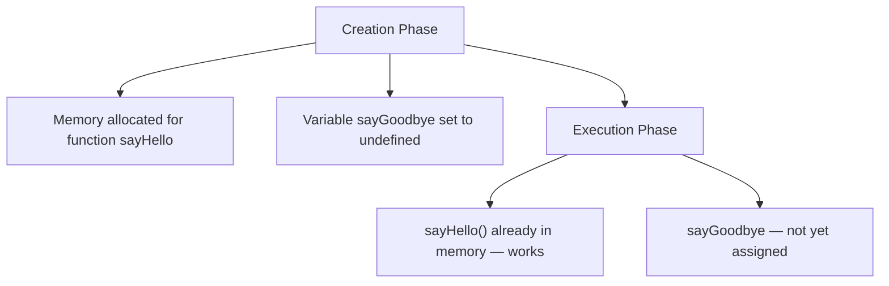

# Function Hoisting

## Introduction

Function hoisting is JavaScript's behavior of moving **function declarations** to the top of their scope during the compilation phase.

## Visual Explanation



## How it Works

```javascript
// ✅ Works — function declaration is hoisted
sayHello(); // 'Hello!'

function sayHello() {
  console.log('Hello!');
}

// ❌ Doesn't work — function expression is NOT hoisted
sayGoodbye(); // TypeError: sayGoodbye is not a function

const sayGoodbye = function() {
  console.log('Goodbye!');
};
```

## Execution Context (Behind the Scenes)



## Summary

- Function declarations are fully hoisted
- Function expressions are NOT hoisted (only variable declaration is hoisted)
- Arrow functions follow the same rules as function expressions
- Prefer function declarations if you need hoisting

## Further Reading

- [MDN: Hoisting](https://developer.mozilla.org/en-US/docs/Glossary/Hoisting)
