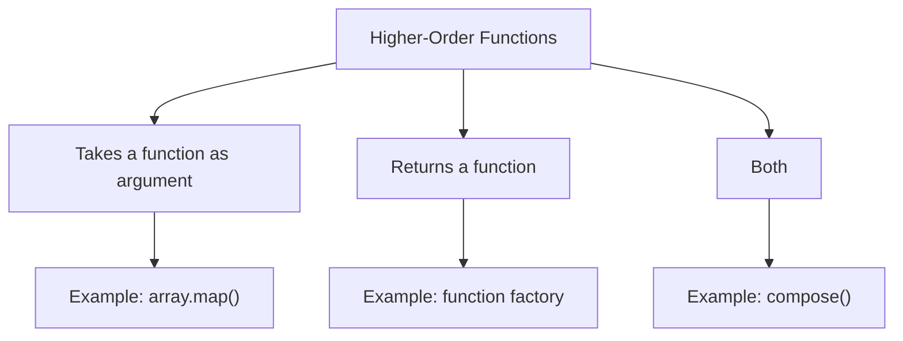

# Higher-Order Functions

## Introduction

A higher-order function (HOF) is a function that **takes other functions as arguments** or **returns a function** as its result.

## Why Do We Need This?

HOFs enable **abstraction**, **code reuse**, and **functional programming** patterns. They are a cornerstone of JavaScript.

## Visual Explanation



## Examples

```javascript
// Takes a function as argument
function withLogging(fn) {
  return function(...args) {
    console.log('Calling:', fn.name);
    return fn(...args);
  };
}

const add = (a, b) => a + b;
const loggedAdd = withLogging(add);
loggedAdd(2, 3); // Logs: 'Calling: add', returns 5

// Returns a function (factory)
function createMultiplier(factor) {
  return function(number) {
    return number * factor;
  };
}

const double = createMultiplier(2);
console.log(double(5)); // 10
```

## Common HOFs

```javascript
// Array methods
[1, 2, 3].map(x => x * 2);      // [2, 4, 6]
[1, 2, 3].filter(x => x > 1);    // [2, 3]
[1, 2, 3].reduce((a, b) => a + b); // 6

// Function composition
const compose = (f, g) => (x) => f(g(x));
const double = x => x * 2;
const add1 = x => x + 1;
const doubleThenAdd1 = compose(add1, double);
console.log(doubleThenAdd1(5)); // 11
```

## Summary

- HOFs take or return functions
- Enable abstraction and code reuse
- Core to functional programming in JavaScript
- Examples: `map`, `filter`, `reduce`, function factories

## Further Reading

- [MDN: Higher-Order Functions](https://developer.mozilla.org/en-US/docs/Glossary/Higher-order_function)
