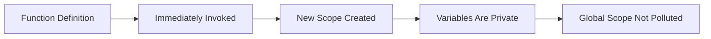

# IIFE (Immediately Invoked Function Expression)

## Introduction

An IIFE is a function that **runs immediately** after being defined. It creates a new scope for variables, preventing them from leaking into the global scope.

## Syntax

```javascript
(function() {
  // code runs immediately
})();

// Arrow function variant
(() => {
  // code runs immediately
})();
```

## Why Do We Need This?

Before ES6 modules, IIFEs were the primary way to create **private scopes** and avoid polluting the global namespace.

## Visual Explanation



## Examples

```javascript
// Private scope
(function() {
  const privateVar = 'secret';
  console.log(privateVar); // 'secret'
})();

console.log(privateVar); // ReferenceError

// Module pattern (pre-ES6)
const module = (function() {
  const private = 'private data';
  return {
    getPrivate: () => private
  };
})();

console.log(module.getPrivate()); // 'private data'
```

## Summary

- IIFE runs immediately after definition
- Creates a private scope
- Was essential for module pattern before ES6
- Still useful for isolated code execution

## Further Reading

- [MDN: IIFE](https://developer.mozilla.org/en-US/docs/Glossary/IIFE)
