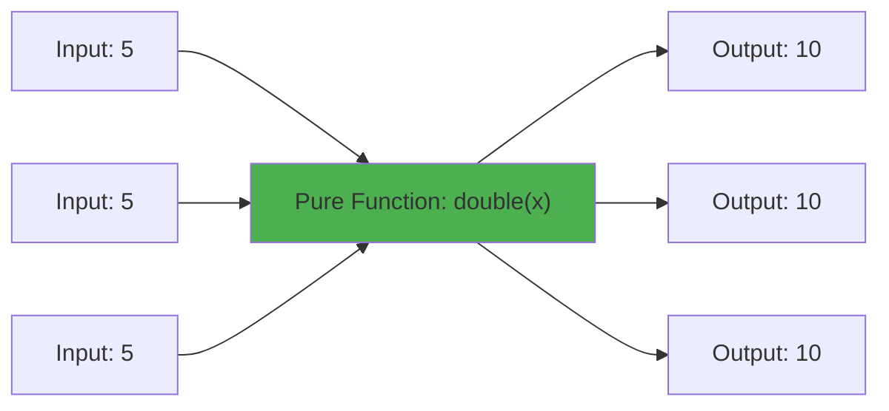

# Pure Functions

## Introduction

A pure function is a function that:
1. Returns the **same output** for the **same input** (deterministic)
2. Has **no side effects** (doesn't modify external state)

## Why Do We Need This?

Pure functions are predictable, testable, and safe to use in concurrent environments. They are fundamental to functional programming.

## Visual Explanation



## Pure vs Impure

```javascript
// ✅ Pure — no side effects
function add(a, b) {
  return a + b;
}

// ❌ Impure — modifies external state
let total = 0;
function addToTotal(value) {
  total += value;
}

// ✅ Pure — same input = same output
function greet(name) {
  return `Hello, ${name}!`;
}

// ❌ Impure — depends on external state
function greetUser() {
  return `Hello, ${userName}!`; // userName is external
}
```

## Benefits

```javascript
// ✅ Easy to test
function double(x) { return x * 2; }
// Test: double(2) always returns 4

// ✅ Cacheable (memoization)
const memoized = (() => {
  const cache = {};
  return (n) => {
    if (cache[n] !== undefined) return cache[n];
    cache[n] = double(n);
    return cache[n];
  };
})();

// ✅ Parallel safe — no shared state
```

## Summary

- Pure functions: same input → same output, no side effects
- Easy to test, cache, and reason about
- Prefer pure functions for predictable code
- Use impure functions only when necessary (IO, state changes)

## Further Reading

- [Wikipedia: Pure Function](https://en.wikipedia.org/wiki/Pure_function)
