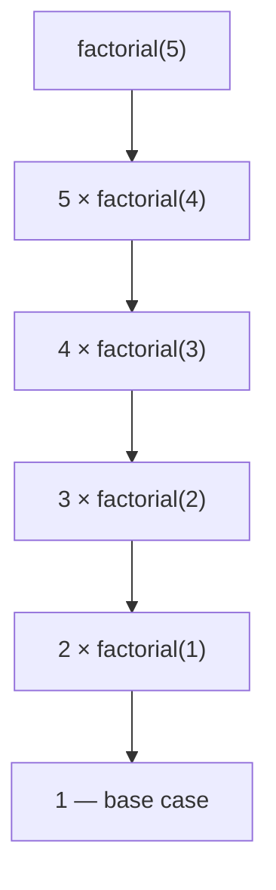

# Recursion

## Introduction

Recursion is a technique where a function **calls itself** to solve a problem by breaking it into smaller subproblems.

## Why Do We Need This?

Recursion is ideal for problems that have a recursive structure: tree traversal, factorial, Fibonacci, and divide-and-conquer algorithms.

## Visual Explanation



## Example

```javascript
function factorial(n) {
  if (n <= 1) return 1; // base case
  return n * factorial(n - 1); // recursive case
}

console.log(factorial(5)); // 120
```

## Key Components

```javascript
function recursiveFunction(params) {
  // 1. Base case — stops the recursion
  if (baseCondition) {
    return baseValue;
  }
  
  // 2. Recursive case — calls itself
  return recursiveFunction(smallerProblem);
}
```

## Common Examples

```javascript
// Fibonacci
function fib(n) {
  if (n <= 1) return n;
  return fib(n - 1) + fib(n - 2);
}

// Tree traversal
function printTree(node) {
  if (!node) return;
  console.log(node.value);
  printTree(node.left);
  printTree(node.right);
}
```

## Summary

- Recursion: function calls itself
- Must have a base case to stop
- Useful for tree/recursive structures
- Be careful with stack overflow for deep recursion

## Further Reading

- [MDN: Recursion](https://developer.mozilla.org/en-US/docs/Glossary/Recursion)
