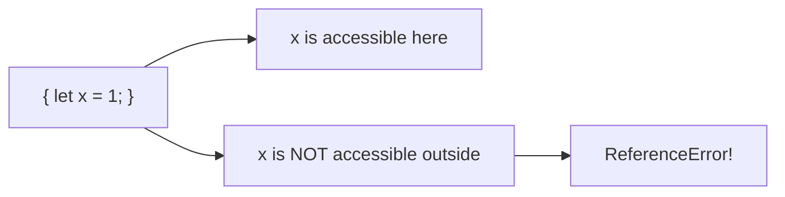

# Block Scope

## Introduction

Block scope confines variables to the block `{}` where they are declared. `let` and `const` have block scope, while `var` does not.

## Visual Explanation



## let and const are Block Scoped

```javascript
{
  let x = 10;
  const y = 20;
  console.log(x, y); // 10, 20
}

console.log(x); // ReferenceError
console.log(y); // ReferenceError
```

## var is NOT Block Scoped

```javascript
{
  var z = 30;
}

console.log(z); // 30 — var leaks out of the block!
```

## Practical Example

```javascript
// Block scope prevents counter leaks
for (let i = 0; i < 3; i++) {
  setTimeout(() => console.log(i), 100);
}
// Logs: 0, 1, 2 (each i is block-scoped)

// VS var — all share the same variable
for (var i = 0; i < 3; i++) {
  setTimeout(() => console.log(i), 100);
}
// Logs: 3, 3, 3 (only one i)
```

## Summary

- `let` and `const` are block scoped
- `var` is function scoped (not block scoped)
- Block scope prevents variable leakage
- Always prefer `let`/`const` over `var`

## Further Reading

- [MDN: Block Statement](https://developer.mozilla.org/en-US/docs/Web/JavaScript/Reference/Statements/block)
