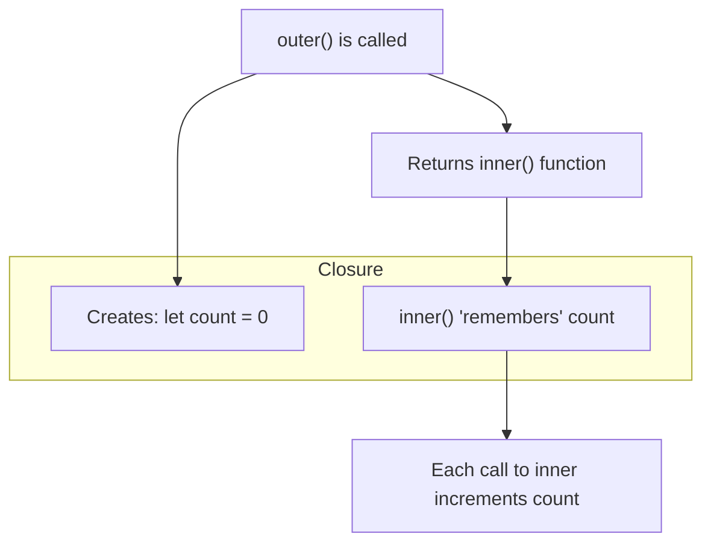

# Closures

## Introduction

A **closure** is a function that **remembers the variables** from its lexical scope even after the outer function has returned. Closures are one of JavaScript's most powerful and distinctive features.

## Real World Story

A closure is like a backpack. When a student leaves a classroom (outer function returns), they still carry their backpack with its contents (closure — variables they had access to).

## Visual Explanation



## Basic Example

```javascript
function createCounter() {
  let count = 0; // "closed over" variable
  
  return function() {
    count++;
    return count;
  };
}

const counter = createCounter();
console.log(counter()); // 1
console.log(counter()); // 2
console.log(counter()); // 3
```

## Common Use Cases

```javascript
// 1. Data encapsulation (private variables)
function createUser(name) {
  let points = 0;
  
  return {
    getName: () => name,
    addPoints: (p) => { points += p; },
    getPoints: () => points
  };
}

const user = createUser('Alice');
user.addPoints(10);
console.log(user.getPoints()); // 10
console.log(user.points); // undefined — private!

// 2. Function factories
function multiplyBy(factor) {
  return (number) => number * factor;
}

const double = multiplyBy(2);
console.log(double(5)); // 10

// 3. Partial application
function add(x) {
  return (y) => x + y;
}

const add5 = add(5);
console.log(add5(3)); // 8
```

## Closure in Loops

```javascript
// Classic closure problem with var
for (var i = 0; i < 3; i++) {
  setTimeout(() => console.log(i), 100);
}
// 3, 3, 3 — all share the same i

// Fix with closure
for (var i = 0; i < 3; i++) {
  ((j) => {
    setTimeout(() => console.log(j), 100);
  })(i);
}
// 0, 1, 2

// Modern fix — use let
for (let i = 0; i < 3; i++) {
  setTimeout(() => console.log(i), 100);
}
// 0, 1, 2
```

## Memory Considerations

```javascript
// Closures keep references to outer variables
function createLargeClosure() {
  const largeArray = new Array(1000000).fill('data');
  
  return function() {
    console.log('closure still holds reference to largeArray');
  };
}
// The largeArray cannot be garbage collected as long as the closure exists
```

## Summary

- A closure is a function + its lexical environment
- Enables data privacy, function factories, and callbacks
- "Remembers" variables even after outer function returns
- Use closures for encapsulation and partial application

## Further Reading

- [MDN: Closures](https://developer.mozilla.org/en-US/docs/Web/JavaScript/Guide/Closures)
- [MDN: Closure](https://developer.mozilla.org/en-US/docs/Web/JavaScript/Closures)
