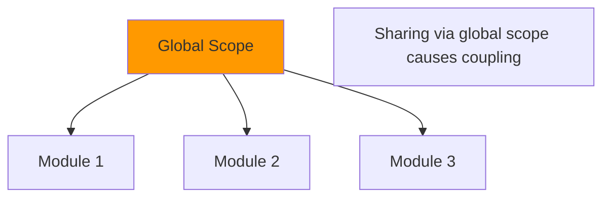

# Global Scope

## Introduction

The global scope is the **top-level scope** in JavaScript. Variables declared in the global scope are accessible from anywhere in the code.

## Visual Explanation



## Key Points

```javascript
// In a browser, the global scope is 'window'
var globalVar = 'I am global';
console.log(window.globalVar); // 'I am global' (in browser)

// In Node.js, the global scope is 'global'
// In ES modules, top-level scope is module scope
```

## Why Avoid Global Scope

```javascript
// ❌ Global pollution
let count = 0;
function increment() { count++; } // modifies global

// ✅ Encapsulated
function createCounter() {
  let count = 0;
  return () => count++;
}
```

## Summary

- Global scope is accessible everywhere
- Minimize global variable usage
- Use modules and functions for encapsulation
- Globals cause naming conflicts and hard-to-debug code

## Further Reading

- [MDN: Global Scope](https://developer.mozilla.org/en-US/docs/Glossary/Global_scope)
