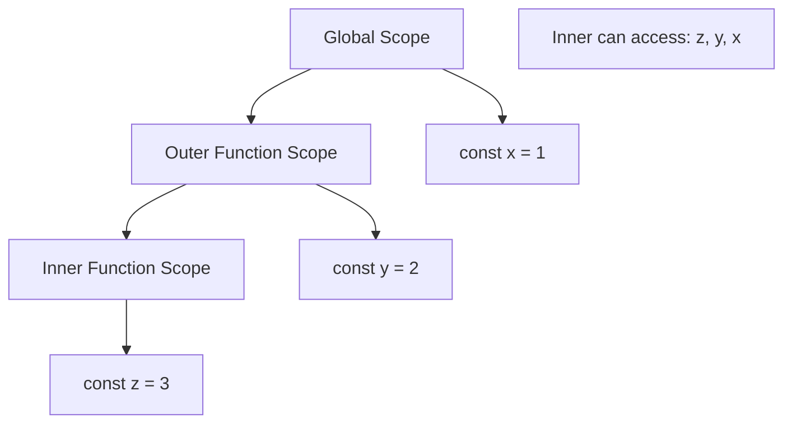

# Lexical Scope

## Introduction

Lexical scope (also called **static scope**) means that the scope of a variable is determined by its **position in the source code**. Inner functions can access variables from outer functions.

## Visual Explanation



## Example

```javascript
const globalVar = 'global';

function outer() {
  const outerVar = 'outer';
  
  function inner() {
    const innerVar = 'inner';
    console.log(innerVar); // 'inner'
    console.log(outerVar); // 'outer'
    console.log(globalVar); // 'global'
  }
  
  inner();
}
```

## Summary

- Lexical scope is based on code structure, not call stack
- Functions can access variables from their containing scopes
- It's "static" — determined at author-time, not runtime

## Further Reading

- [MDN: Scope](https://developer.mozilla.org/en-US/docs/Glossary/Scope)
