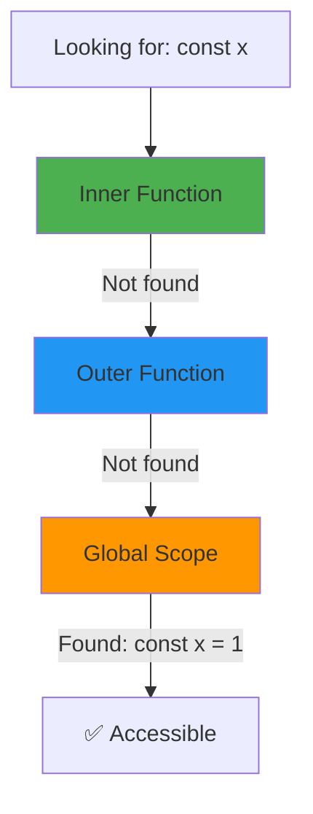

# Scope Chain

## Introduction

The scope chain is the **hierarchy of scopes** that JavaScript traverses to resolve a variable. It starts at the innermost scope and goes outward.

## Visual Explanation



## How it Works

```javascript
const global = 1;

function outer() {
  const outerVar = 2;
  
  function inner() {
    const innerVar = 3;
    
    // Scope chain: inner → outer → global
    console.log(innerVar); // 3 — found in current scope
    console.log(outerVar); // 2 — found in outer scope
    console.log(global);   // 1 — found in global scope
  }
  
  inner();
}
```

## Shadowing

```javascript
const value = 'global';

function myFunction() {
  const value = 'local'; // shadows global
  console.log(value); // 'local'
}

myFunction();
```

## Summary

- Scope chain resolves variables from inner to outer
- Variable shadowing occurs when inner scope declares same name
- The chain stops at the global scope
- Understanding the chain prevents variable resolution bugs

## Further Reading

- [MDN: Scope Chain](https://developer.mozilla.org/en-US/docs/Web/JavaScript/Guide/Closures)
