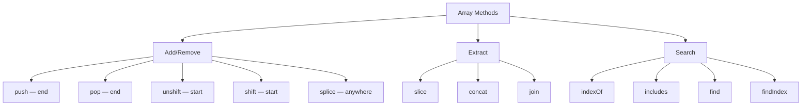

# Array Methods

## Introduction

JavaScript arrays have a rich set of methods for manipulating data. These can be categorized as **mutating** (change the original array) and **non-mutating** (return a new array).

## Visual Explanation



## Mutating Methods

```javascript
const arr = [1, 2, 3];

arr.push(4);      // [1, 2, 3, 4] — add to end
arr.pop();        // [1, 2, 3] — remove from end
arr.unshift(0);   // [0, 1, 2, 3] — add to start
arr.shift();      // [1, 2, 3] — remove from start
arr.splice(1, 1, 'a'); // [1, 'a', 3] — replace at index
```

## Non-Mutating Methods

```javascript
const arr = [1, 2, 3, 4, 5];

arr.slice(1, 3);     // [2, 3] — extract portion
arr.concat([6, 7]);  // [1, 2, 3, 4, 5, 6, 7]
arr.join('-');       // '1-2-3-4-5'
[...arr];            // shallow copy
```

## Search Methods

```javascript
[1, 2, 3].indexOf(2);    // 1
[1, 2, 3].includes(2);   // true
[1, 2, 3].find(x => x > 1); // 2
[1, 2, 3].findIndex(x => x > 1); // 1
```

## Summary

- `push/pop` — fast operations at the end
- `shift/unshift` — slower (re-indexes array)
- `splice` — versatile add/remove/replace
- `slice` — safe, non-mutating extraction

## Further Reading

- [MDN: Array Methods](https://developer.mozilla.org/en-US/docs/Web/JavaScript/Reference/Global_Objects/Array#instance_methods)
